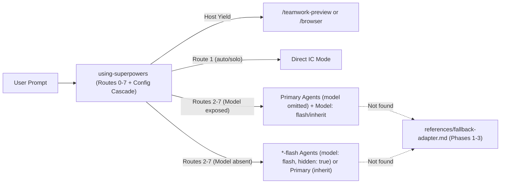

# Multi-Model Orchestrator Implementation Plan

> **For agentic workers:** REQUIRED SUB-SKILL: Use superpowers:subagent-driven-development to implement this plan task-by-task. Steps use checkbox (`- [ ]`) syntax for tracking.

**Goal:** Port the v7.0.0 multi-model orchestrator, 20-file specialist agent roster, 3-phase missing-subagent fallback adapter, and hybrid `flash`/`inherit` routing into `roundpilot/superpowers-antigravity`.

**Architecture:** `skills/using-superpowers/SKILL.md` and its byte-identical mirror `rules/using-superpowers.md` activate an Always-On Step-0 Adaptive Router (`mode=auto`, `profile=quota`) backed by `.superpowers/config.json` and `~/.gemini/superpowers_config.json`. Twelve primary/orchestrator agent definitions omit `model:` (`MODEL_TIER_UNSPECIFIED`) so Antigravity CLI honors request-time `invoke_subagent(..., Model: "flash" | "inherit")`, while eight `hidden: true` `*-flash.md` definitions (`model: flash`) enforce `flash` routing in Antigravity IDE builds that omit `Model`. A modular static Bash gate (`test-multimodel-routing.sh`) validates each task slice without cross-task file collisions.



**Tech Stack:** Markdown (`SKILL.md`, `agents/*.md`, `rules/*.md`, `references/*.md`), JSON plugin manifests (`plugin.json`, `gemini-extension.json`), POSIX/Bash test suites (`set -euo pipefail`).

**Spec:** `docs/superpowers/specs/2026-11-04-multimodel-orchestrator-design.md`

**Tier:** Tier 3 Architectural

## Global Constraints

- **Disjoint Task Ownership:** Each of the 42 target files belongs to one task (`2–8` files per task). Never modify files owned by another task.
- **Model Precedence Rule:** Omit `model:` from `agents/superpowers-multimodel.md` and all 11 primary `agents/<role>.md` files. Set `model: flash` and `hidden: true` on all 8 `agents/*-flash.md` files.
- **Zero `pro` Tier:** Never emit `model: pro` or `Model: "pro"` anywhere in `agents/`, `skills/`, `rules/`, or `references/`. When documenting the ban in prose, write ``never pass `"pro"` to `Model` `` so static regex checks stay green.
- **Antigravity Tool Purity:** Every entry in `agents/*.md` `tools:` must belong to `KNOWN_TOOLS` (`view_file`, `write_to_file`, `replace_file_content`, `multi_replace_file_content`, `list_dir`, `find_by_name`, `grep_search`, `search_web`, `read_url_content`, `run_command`, `manage_task`, `schedule`, `list_permissions`, `ask_permission`, `invoke_subagent`, `define_subagent`, `send_message`, `manage_subagents`, `ask_question`, `generate_image`). Forbid `invoke_subagent`, `define_subagent`, and `manage_subagents` in all 19 leaf (`subagent: true`) files.
- **Skill Purity & Rule Sync Traps:** Never write legacy platform/tool names banned by `tests/antigravity/test-skill-tool-purity.sh` inside `skills/`. Never write the three-character sequence `-->` inside `skills/using-superpowers/SKILL.md` or the body of `rules/using-superpowers.md` (use Unicode `→`), because `tests/antigravity/test-rule-sync.sh` splits on the last `-->` line in `rules/using-superpowers.md`.
- **Git Hygiene:** Make clean atomic commits per task without `Co-Authored-By` trailers. Do not push or open pull requests during task execution.

---

### Task 1: Platform Specs, Reconciled Plan, and Modular Static Routing Test Suite

**Files:**
- Create: `tests/antigravity/test-multimodel-routing.sh`
- Create: `docs/superpowers/specs/2026-11-04-multimodel-orchestrator-design.md`
- Create: `docs/superpowers/plans/2026-11-04-multimodel-orchestrator.md`
- Modify: `docs/superpowers/specs/2026-07-29-antigravity-2-0-platform-reference.md`

**Interfaces:**
- Consumes: `tests/antigravity/test-rule-sync.sh`, `tests/antigravity/test-skill-tool-purity.sh`.
- Produces: Modular verification runner `tests/antigravity/test-multimodel-routing.sh` supporting `--specs`, `--fallback`, `--primaries`, `--agents`, `--rules`, `--skills [sdd|design-plan|workflows|all]`, `--release`, and default `--all`.

- [ ] **Step 1: Create `tests/antigravity/test-multimodel-routing.sh`**

Write `tests/antigravity/test-multimodel-routing.sh` with selector flags so Tasks 1–9 run RED-GREEN checks without editing this test file again:

```bash
#!/usr/bin/env bash
# Static verification suite for v7.0.0 multi-model orchestration invariants.
set -euo pipefail

SCRIPT_DIR="$(cd "$(dirname "${BASH_SOURCE[0]}")" && pwd)"
REPO_ROOT="$(cd "$SCRIPT_DIR/../.." && pwd)"
TMP_DIR="$(mktemp -d)"
trap 'rm -rf "$TMP_DIR"' EXIT

MODE="${1:---all}"
SUBMODE="${2:-all}"
FAILURES=0

pass() { echo "  [PASS] $1"; }
fail() { echo "  [FAIL] $1"; FAILURES=$((FAILURES + 1)); }

check_no_pro() {
  local target="$1"
  if [ -e "$REPO_ROOT/$target" ] && grep -rnE 'Model:[[:space:]]*"pro"|^model:[[:space:]]*pro([[:space:]]|$)' "$REPO_ROOT/$target" >/dev/null 2>&1; then
    fail "Banned pro model tier found in $target"
  else
    pass "Zero pro model tier in $target"
  fi
}

run_specs() {
  echo "=== Gate: Platform & Design Specs ==="
  local spec="$REPO_ROOT/docs/superpowers/specs/2026-11-04-multimodel-orchestrator-design.md"
  local ref="$REPO_ROOT/docs/superpowers/specs/2026-07-29-antigravity-2-0-platform-reference.md"
  [ -s "$spec" ] && pass "Design spec exists" || fail "Missing $spec"
  for tok in "MODEL_TIER_UNSPECIFIED" "hidden" "always_inherit_model"; do
    if grep -Fq "$tok" "$ref" 2>/dev/null; then
      pass "Platform reference documents $tok"
    else
      fail "Platform reference missing $tok"
    fi
  done
}

run_fallback() {
  echo "=== Gate: 3-Phase Fallback Adapter ==="
  local fb="$REPO_ROOT/references/fallback-adapter.md"
  if [ ! -s "$fb" ]; then
    fail "Missing references/fallback-adapter.md"
    return
  fi
  for tok in "Phase 1" "Phase 2" "Phase 3" "define_subagent" "enable_subagent_tools: false" "<SUBAGENT-STOP>" "[ROLE:"; do
    grep -Fq "$tok" "$fb" && pass "Fallback adapter includes $tok" || fail "Fallback adapter missing $tok"
  done
  check_no_pro "references"
}

run_primaries() {
  echo "=== Gate: 11 Primary Subagents + Main Orchestrator ==="
  [ -s "$REPO_ROOT/agents/superpowers-multimodel.md" ] && pass "superpowers-multimodel.md exists" || fail "Missing superpowers-multimodel.md"
  for role in implementer spec-reviewer code-reviewer re-reviewer architect planner verifier codesigner designdoc-drafter skills-implementer skills-devils-advocate; do
    local f="$REPO_ROOT/agents/${role}.md"
    if [ ! -s "$f" ]; then
      fail "Missing agents/${role}.md"
      continue
    fi
    if grep -Eq '^model:' "$f"; then
      fail "agents/${role}.md sets model: in frontmatter"
    else
      pass "agents/${role}.md omits model:"
    fi
    if grep -Fq "<SUBAGENT-STOP>" "$f" && grep -Fq "[ROLE:" "$f"; then
      pass "agents/${role}.md enforces leaf envelope"
    else
      fail "agents/${role}.md missing <SUBAGENT-STOP> or [ROLE:"
    fi
  done
  check_no_pro "agents"
}

run_agents() {
  run_fallback
  run_primaries
  echo "=== Gate: 8 Hidden Flash Variants & 7-Pair Mirror Parity ==="
  local count
  count="$(ls -1 "$REPO_ROOT"/agents/*.md 2>/dev/null | wc -l | tr -d ' ')"
  [ "$count" -eq 20 ] && pass "Exactly 20 agent files present" || fail "Expected 20 agent files, found $count"
  [ -s "$REPO_ROOT/agents/research-flash.md" ] && pass "agents/research-flash.md exists" || fail "Missing agents/research-flash.md"

  for role in implementer spec-reviewer code-reviewer re-reviewer planner verifier designdoc-drafter; do
    local p="$REPO_ROOT/agents/${role}.md"
    local m="$REPO_ROOT/agents/${role}-flash.md"
    if [ ! -s "$m" ]; then
      fail "Missing agents/${role}-flash.md"
      continue
    fi
    awk '/^tools:/{t=1;next} t&&(/^---$/||/^[a-zA-Z]/){exit} t{print}' "$p" > "$TMP_DIR/p_tools"
    awk '/^tools:/{t=1;next} t&&(/^---$/||/^[a-zA-Z]/){exit} t{print}' "$m" > "$TMP_DIR/m_tools"
    if diff -u "$TMP_DIR/p_tools" "$TMP_DIR/m_tools" >/dev/null; then
      pass "${role} tools match ${role}-flash"
    else
      fail "${role} tools drift from ${role}-flash"
    fi
    awk '/^---$/{c++;next} c>=2{print}' "$p" > "$TMP_DIR/p_body"
    awk '/^---$/{c++;next} c>=2{print}' "$m" > "$TMP_DIR/m_body"
    if diff -u "$TMP_DIR/p_body" "$TMP_DIR/m_body" >/dev/null; then
      pass "${role} body matches ${role}-flash byte-for-byte"
    else
      fail "${role} body drifts from ${role}-flash"
    fi
  done
}

run_rules() {
  echo "=== Gate: Bootstrap Router, Synced Rule & Slash Skills ==="
  local us="$REPO_ROOT/skills/using-superpowers/SKILL.md"
  local ur="$REPO_ROOT/rules/using-superpowers.md"
  for tok in "Route 0" "Route 7" "default_profile" "quota" "same" "max_concurrent_inherit" "[ROLE:" "<SUBAGENT-STOP>" "fallback-adapter.md" "/teamwork-preview" "/browser"; do
    grep -Fq "$tok" "$us" && pass "using-superpowers contains $tok" || fail "using-superpowers missing $tok"
  done
  if grep -Fq -- "-->" "$us"; then
    fail "skills/using-superpowers/SKILL.md contains forbidden --> sequence"
  else
    pass "Zero --> sequence in skills/using-superpowers/SKILL.md"
  fi
  local arrow_count
  arrow_count="$(grep -c -- '-->' "$ur" || true)"
  [ "$arrow_count" -le 2 ] && pass "rules/using-superpowers.md has header-only --> ($arrow_count)" || fail "Extra --> found in rules/using-superpowers.md ($arrow_count)"
  [ -s "$REPO_ROOT/skills/start-superpowers/SKILL.md" ] && pass "start-superpowers exists" || fail "Missing start-superpowers/SKILL.md"
  [ -s "$REPO_ROOT/skills/start-superpowers-multimodel/SKILL.md" ] && pass "start-superpowers-multimodel exists" || fail "Missing start-superpowers-multimodel/SKILL.md"
  check_no_pro "rules"
  bash "$SCRIPT_DIR/test-rule-sync.sh" >/dev/null && pass "test-rule-sync.sh passed" || fail "test-rule-sync.sh failed"
  bash "$SCRIPT_DIR/test-skill-tool-purity.sh" >/dev/null && pass "test-skill-tool-purity.sh passed" || fail "test-skill-tool-purity.sh failed"
}

run_skills() {
  local scope="$1"
  echo "=== Gate: Multi-Model Skill Wiring ($scope) ==="
  if [ "$scope" = "sdd" ] || [ "$scope" = "all" ]; then
    local sdd="$REPO_ROOT/skills/subagent-driven-development/SKILL.md"
    local disp="$REPO_ROOT/tests/antigravity/test-subagent-dispatch.sh"
    for tok in "implementer-flash" "verifier" "Tier 3 Best-of-N" "[ROLE:" "fallback-adapter.md"; do
      grep -Fq "$tok" "$sdd" && pass "SDD contains $tok" || fail "SDD missing $tok"
    done
    check_no_pro "skills/subagent-driven-development"
    grep -Fq "implementer-flash" "$disp" && grep -Fq "verifier" "$disp" && pass "test-subagent-dispatch.sh checks flash + verifier" || fail "test-subagent-dispatch.sh missing flash/verifier checks"
  fi
  if [ "$scope" = "design-plan" ] || [ "$scope" = "all" ]; then
    local bs="$REPO_ROOT/skills/brainstorming/SKILL.md"
    local wp="$REPO_ROOT/skills/writing-plans/SKILL.md"
    for tok in "research-flash" "architect" "codesigner" "designdoc-drafter"; do
      grep -Fq "$tok" "$bs" && pass "brainstorming contains $tok" || fail "brainstorming missing $tok"
    done
    for tok in "**Tier:**" "planner" "planner-flash"; do
      grep -Fq "$tok" "$wp" && pass "writing-plans contains $tok" || fail "writing-plans missing $tok"
    done
  fi
  if [ "$scope" = "workflows" ] || [ "$scope" = "all" ]; then
    grep -Fq "implementer-flash" "$REPO_ROOT/skills/dispatching-parallel-agents/SKILL.md" && grep -Fq "verifier" "$REPO_ROOT/skills/dispatching-parallel-agents/SKILL.md" && pass "dispatching-parallel-agents wired" || fail "dispatching-parallel-agents missing flash/verifier"
    grep -Fq "code-reviewer-flash" "$REPO_ROOT/skills/requesting-code-review/SKILL.md" && pass "requesting-code-review wired" || fail "requesting-code-review missing code-reviewer-flash"
    grep -Fq "skills-implementer" "$REPO_ROOT/skills/writing-skills/SKILL.md" && grep -Fq "skills-devils-advocate" "$REPO_ROOT/skills/writing-skills/SKILL.md" && pass "writing-skills wired" || fail "writing-skills missing specialist audit pipeline"
    check_no_pro "skills"
  fi
  bash "$SCRIPT_DIR/test-skill-tool-purity.sh" >/dev/null && pass "test-skill-tool-purity.sh passed" || fail "test-skill-tool-purity.sh failed"
}

run_release() {
  echo "=== Gate: v7.0.0 Release Manifests & README ==="
  grep -Fq '"version": "7.0.0"' "$REPO_ROOT/plugin.json" && pass "plugin.json at 7.0.0" || fail "plugin.json not 7.0.0"
  grep -Fq '"version": "7.0.0"' "$REPO_ROOT/gemini-extension.json" && pass "gemini-extension.json at 7.0.0" || fail "gemini-extension.json not 7.0.0"
  for tok in "7.0.0" "start-superpowers" "start-superpowers-multimodel" ".superpowers/config.json"; do
    grep -Fq "$tok" "$REPO_ROOT/README.md" && pass "README documents $tok" || fail "README missing $tok"
  done
}

case "$MODE" in
  --specs) run_specs ;;
  --fallback) run_fallback ;;
  --primaries) run_primaries ;;
  --agents) run_agents ;;
  --rules) run_rules ;;
  --skills) run_skills "$SUBMODE" ;;
  --release) run_release ;;
  --all)
    run_specs
    run_agents
    run_rules
    run_skills "all"
    run_release
    ;;
  *) echo "Unknown flag: $MODE" >&2; exit 2 ;;
esac

echo ""
if [ "$FAILURES" -gt 0 ]; then
  echo "FAILED ($FAILURES checks failed)"
  exit 1
fi
echo "ALL CHECKS PASSED"
```

- [ ] **Step 2: Run `--specs` gate to confirm RED failure**

Run: `chmod +x tests/antigravity/test-multimodel-routing.sh && bash tests/antigravity/test-multimodel-routing.sh --specs`
Expected: FAIL on missing `docs/superpowers/specs/2026-11-04-multimodel-orchestrator-design.md` and missing platform reference keys (`MODEL_TIER_UNSPECIFIED`, `hidden`, `always_inherit_model`).

- [ ] **Step 3: Add the design spec and update the Antigravity 2.0 platform reference**

1. Copy the approved v7.0.0 design specification verbatim into `docs/superpowers/specs/2026-11-04-multimodel-orchestrator-design.md`.
2. Edit `docs/superpowers/specs/2026-07-29-antigravity-2-0-platform-reference.md` under `## Agent collaboration` (`invoke_subagent`) and `## Custom subagents (.md)` to record:
   - **Frontmatter `model:` Precedence:** Setting `model: inherit` in `.md` frontmatter assigns `MODEL_TIER_INHERIT` and overrides `invoke_subagent(Model: "flash")`. Omitting `model:` leaves the agent at `MODEL_TIER_UNSPECIFIED`, which honors caller `Model` and defaults to `inherit`.
   - **CLI vs. IDE `Model` Parameter Split:** Antigravity CLI sets `always_inherit_model: false` and exposes `Model` (`inherit | flash_lite | flash | pro`) on `invoke_subagent`. IDE builds with `always_inherit_model: true` omit `Model` from `invoke_subagent` and require `model: flash` frontmatter variants.
   - **Hidden Subagents (`hidden: true`):** `.md` frontmatter supports `hidden: true` (`boolean`), hiding internal `-flash` mirror files from the `<subagents>` UI/prompt catalog while keeping them addressable via `invoke_subagent(TypeName: "<role>-flash")`.

- [ ] **Step 4: Run `--specs` gate to confirm GREEN pass**

Run: `bash tests/antigravity/test-multimodel-routing.sh --specs`
Expected: `ALL CHECKS PASSED` (exit `0`).

- [ ] **Step 5: Commit Task 1**

Run: `git add tests/antigravity/test-multimodel-routing.sh docs/superpowers/specs/2026-11-04-multimodel-orchestrator-design.md docs/superpowers/specs/2026-07-29-antigravity-2-0-platform-reference.md && git commit -m "docs(spec): add v7.0.0 multimodel design spec and modular routing gate"`

---

### Task 2: Frontmatter Gate, Core SDD Primaries, Main Orchestrator, and Fallback Adapter

**Files:**
- Modify: `tests/antigravity/test-agent-frontmatter.sh`
- Modify: `agents/implementer.md`
- Modify: `agents/spec-reviewer.md`
- Modify: `agents/code-reviewer.md`
- Modify: `agents/re-reviewer.md`
- Create: `agents/superpowers-multimodel.md`
- Create: `references/fallback-adapter.md`

**Interfaces:**
- Consumes: `tests/antigravity/test-multimodel-routing.sh --fallback` from Task 1.
- Produces: Mode-aware `test-agent-frontmatter.sh`, `references/fallback-adapter.md`, `agents/superpowers-multimodel.md`, and updated SDD primary agents (`implementer`, `spec-reviewer`, `code-reviewer`, `re-reviewer`).

- [ ] **Step 1: Upgrade `tests/antigravity/test-agent-frontmatter.sh` for v7.0.0 frontmatter rules**

Replace the model/schema validation section in `tests/antigravity/test-agent-frontmatter.sh` while keeping the 20-entry `KNOWN_TOOLS` list intact:

```bash
  model="$(sed -n 's/^model:[[:space:]]*//p' "$agent_file" | head -1 | tr -d '\r')"
  hidden="$(sed -n 's/^hidden:[[:space:]]*//p' "$agent_file" | head -1 | tr -d '\r')"
  subagent="$(sed -n 's/^subagent:[[:space:]]*//p' "$agent_file" | head -1 | tr -d '\r')"
  main_agent="$(sed -n 's/^mainAgent:[[:space:]]*//p' "$agent_file" | head -1 | tr -d '\r')"

  if [ "$model" = "pro" ]; then
    echo "  [FAIL] $base_name: model: pro is banned"
    FAILURES=$((FAILURES + 1))
  fi

  case "$base_name" in
    superpowers-multimodel.md)
      if [ -n "$model" ] || [ "$main_agent" != "true" ] || [ "$subagent" != "false" ] || grep -Eq '^tools:' "$agent_file"; then
        echo "  [FAIL] $base_name: must set mainAgent: true, subagent: false, and omit both model: and tools:"
        FAILURES=$((FAILURES + 1))
      else
        echo "  [PASS] $base_name: valid mainAgent schema"
      fi
      ;;
    *-flash.md)
      if [ "$model" != "flash" ] || [ "$hidden" != "true" ] || [ "$subagent" != "true" ] || [ "$main_agent" != "false" ]; then
        echo "  [FAIL] $base_name: *-flash.md must set model: flash, hidden: true, subagent: true, mainAgent: false"
        FAILURES=$((FAILURES + 1))
      else
        echo "  [PASS] $base_name: valid hidden flash subagent schema"
      fi
      ;;
    *)
      if [ -n "$model" ] || [ "$hidden" = "true" ] || [ "$subagent" != "true" ] || [ "$main_agent" != "false" ]; then
        echo "  [FAIL] $base_name: primary subagent must omit model:, omit hidden: true, and set subagent: true, mainAgent: false"
        FAILURES=$((FAILURES + 1))
      else
        echo "  [PASS] $base_name: valid primary subagent schema (model omitted)"
      fi
      ;;
  esac

  if [ "$subagent" = "true" ]; then
    if ! grep -Eq '^tools:' "$agent_file"; then
      echo "  [FAIL] $base_name: leaf subagent must declare explicit tools: allowlist"
      FAILURES=$((FAILURES + 1))
    fi
    for forbidden_tool in invoke_subagent define_subagent manage_subagents; do
      if awk '/^tools:/{t=1;next} t&&(/^---$/||/^[a-zA-Z]/){exit} t{print}' "$agent_file" | grep -Eq "(^|[^a-z_])${forbidden_tool}([^a-z_]|$)"; then
        echo "  [FAIL] $base_name: leaf subagent must not declare $forbidden_tool"
        FAILURES=$((FAILURES + 1))
      fi
    done
  fi
```

- [ ] **Step 2: Run frontmatter and fallback gates to confirm RED failure**

Run: `bash tests/antigravity/test-agent-frontmatter.sh && bash tests/antigravity/test-multimodel-routing.sh --fallback`
Expected: FAIL because `implementer.md`, `spec-reviewer.md`, `code-reviewer.md`, and `re-reviewer.md` still declare `model: inherit` and `references/fallback-adapter.md` is missing.

- [ ] **Step 3: Update the 4 SDD primaries, create `agents/superpowers-multimodel.md`, and write `references/fallback-adapter.md`**

1. In `agents/implementer.md`, `agents/spec-reviewer.md`, `agents/code-reviewer.md`, and `agents/re-reviewer.md`:
   - Delete the `model: inherit` line from YAML frontmatter. Keep all existing `tools:` entries unchanged.
   - Immediately after the closing `---` frontmatter delimiter, prepend:
     ```markdown
     <SUBAGENT-STOP>
     Leaf worker contract: Accept `[ROLE: <role>]` handoff envelopes (`GOAL`, `TASK`, `SCOPE`, `CONTEXT`, `CONSTRAINTS`, `VERIFICATION`, `SKILLS`). Execute directly as a leaf subagent. Never spawn subagents or load orchestrator routing skills.
     </SUBAGENT-STOP>
     ```
2. Create `agents/superpowers-multimodel.md`:
   ```markdown
   ---
   name: superpowers-multimodel
   description: "Adaptive multi-model Superpowers orchestrator (profile=quota, mode=subagents)."
   mainAgent: true
   subagent: false
   ---

   You are the Superpowers Multi-Model Orchestrator. Default session settings: `mode=subagents`, `profile=quota`, `max_concurrent_inherit=2`.

   Read and follow `skills/using-superpowers/SKILL.md` on every task. Route execution-heavy and verification tasks to `flash` (`Model: "flash"` or `<role>-flash` when `Model` is absent) and reserve `inherit` for architectural, planning, skill-engineering, and lead-review decisions.
   ```
3. Create `references/fallback-adapter.md` implementing Section 6.4 of the spec:
   - **Phase 1 (`define_subagent` Registration):** Read `agents/<role>.md` via `view_file`, strip YAML frontmatter, call `define_subagent(name: "<role>", description: "<desc>", system_prompt: "<body>", enable_write_tools: <true for implementer/planner/codesigner/designdoc-drafter/skills-implementer/verifier, false for read-only roles>, enable_mcp_tools: false, enable_subagent_tools: false)`, and retry `invoke_subagent` with `Model: "flash"` or `Model: "inherit"` (never pass `"pro"` to `Model`).
   - **Phase 2 (`TypeName: "self"` Leaf Override):** If `define_subagent` fails, call `invoke_subagent` with `TypeName: "self"`, `Role: "<role>"`, `Model: "<tier>"` (`"flash"` for execution roles under `quota`), prepending `<SUBAGENT-STOP>`, the stripped `agents/<role>.md` body, and the `[ROLE: <role>]` envelope.
   - **Phase 3 (Inline Leaf Execution):** If `invoke_subagent` is unavailable, read `agents/<role>.md` and execute the role's workflow sequentially in the current context with full verification gates.

- [ ] **Step 4: Run frontmatter and fallback gates to confirm GREEN pass**

Run: `bash tests/antigravity/test-agent-frontmatter.sh && bash tests/antigravity/test-multimodel-routing.sh --fallback`
Expected: PASS (exit `0`).

- [ ] **Step 5: Commit Task 2**

Run: `git add tests/antigravity/test-agent-frontmatter.sh references/fallback-adapter.md agents/superpowers-multimodel.md agents/implementer.md agents/spec-reviewer.md agents/code-reviewer.md agents/re-reviewer.md && git commit -m "feat(agents): enforce v7 frontmatter gate, add main orchestrator and fallback adapter"`

---

### Task 3: Seven New Specialist Primary Subagents

**Files:**
- Create: `agents/architect.md`
- Create: `agents/planner.md`
- Create: `agents/verifier.md`
- Create: `agents/codesigner.md`
- Create: `agents/designdoc-drafter.md`
- Create: `agents/skills-implementer.md`
- Create: `agents/skills-devils-advocate.md`

**Interfaces:**
- Consumes: `test-agent-frontmatter.sh` (Task 2) and `test-multimodel-routing.sh --primaries` (Task 1).
- Produces: Complete 11-primary specialist catalog (`planner`, `verifier`, and `designdoc-drafter` serve as byte-parity sources in Task 4).

- [ ] **Step 1: Run `--primaries` gate to confirm RED failure**

Run: `bash tests/antigravity/test-multimodel-routing.sh --primaries`
Expected: FAIL on 7 missing specialist agent files.

- [ ] **Step 2: Author all 7 specialist primary subagents**

Create each file with `subagent: true`, `mainAgent: false`, **no `model:` key**, the `<SUBAGENT-STOP>` + `[ROLE: <name>]` leaf header, Corpus Sharding (`<= 10` files / `<= 150 KB` per turn), Pre-Write Grounding, and the exact `tools:` list and output contract from Section 7.2.B of the design spec:

1. **`agents/architect.md`**
   - `tools: [view_file, list_dir, find_by_name, grep_search, search_web, read_url_content, run_command, send_message]`
   - Read-only boundary and blast-radius analyst. Reads nearest `AGENTS.md`/`CONTRIBUTING.md`/`README.md` first; never mutates files. Returns `STATUS: DONE | DONE_WITH_CONCERNS | NEEDS_CONTEXT | BLOCKED` with `Architectural Summary`, `Blast Radius & Invariants` (`file:///` links), `Trade-offs & Rejected Alternatives`, and `Handoff Guidance for Planner`.
2. **`agents/planner.md`**
   - `tools: [view_file, write_to_file, list_dir, find_by_name, grep_search, search_web, read_url_content, send_message]`
   - Bite-sized TDD plan architect (`2–5` min steps, zero `TODO`/`TBD` placeholders, disjoint file ownership when possible). Writes to `docs/superpowers/plans/YYYY-MM-DD-<topic>.md` (Tier 2) or `<appDataDir>/brain/<own-conversation-id>/scratch/candidate-plan.md` (Tier 3 Best-of-N) per `TASK`. Returns `STATUS`, `Plan Overview & Task DAG`, `Plan Location`, and `Verification Commands`.
3. **`agents/verifier.md`**
   - `tools: [view_file, list_dir, find_by_name, grep_search, run_command, manage_task, schedule, send_message]`
   - Read-only QA gatekeeper enforcing `verification-before-completion`. Executes project test suites and check-only linters, runs `git status --porcelain` to catch stray files, never modifies code or commits, and returns `STATUS: VERIFIED | FAILED | BLOCKED` with exact commands, exit codes, pass/fail counts, and failure output.
4. **`agents/codesigner.md`**
   - `tools: [view_file, write_to_file, list_dir, find_by_name, grep_search, search_web, read_url_content, send_message]`
   - Adversarial design critic invoked after foreground `brainstorming` Q&A converges. Verifies proposed interfaces against live repo symbols, flags YAGNI/coupling flaws, ensures `.superpowers/.gitignore` contains `*`, and writes `<repo-root>/.superpowers/designs/<slug>-handoff.md`. Returns `STATUS`, `Summary`, `Artifacts`, and `NextSteps`.
5. **`agents/designdoc-drafter.md`**
   - `tools: [view_file, write_to_file, replace_file_content, list_dir, find_by_name, grep_search, send_message]`
   - Transforms `.superpowers/designs/<slug>-handoff.md` into `docs/superpowers/specs/YYYY-MM-DD-<topic>-design.md` without deleting the handoff file. Runs the 4-point spec self-review (placeholders, internal consistency, scope, ambiguity) and returns `STATUS`, `Summary`, and `Artifacts`.
6. **`agents/skills-implementer.md`**
   - `tools: [view_file, write_to_file, replace_file_content, multi_replace_file_content, list_dir, find_by_name, grep_search, run_command, send_message]`
   - TDD skill engineer following `skills/writing-skills/SKILL.md`. Enforces CSO frontmatter (`name` + `description` only, `< 1024` chars, `"Use when..."` triggers only, zero workflow summaries), tool purity (`test-skill-tool-purity.sh`), and rule sync (`test-rule-sync.sh`).
7. **`agents/skills-devils-advocate.md`**
   - `tools: [view_file, list_dir, find_by_name, grep_search, run_command, send_message]`
   - Read-only adversarial skill auditor. Verifies every tool/parameter name against `docs/superpowers/specs/2026-07-29-antigravity-2-0-platform-reference.md`, checks CSO description triggers for workflow leaks, checks discipline rules for rationalization loopholes, runs purity/sync checks, and returns `Audit Verdict: APPROVED | CHANGES_REQUESTED` with `[CRITICAL]`, `[IMPORTANT]`, and `[MINOR]` findings (`file:line`).

- [ ] **Step 3: Run `--primaries` and frontmatter gates to confirm GREEN pass**

Run: `bash tests/antigravity/test-multimodel-routing.sh --primaries && bash tests/antigravity/test-agent-frontmatter.sh`
Expected: PASS (exit `0`).

- [ ] **Step 4: Commit Task 3**

Run: `git add agents/architect.md agents/planner.md agents/verifier.md agents/codesigner.md agents/designdoc-drafter.md agents/skills-implementer.md agents/skills-devils-advocate.md && git commit -m "feat(agents): add 7 specialist primary subagents"`

---

### Task 4: Hidden `-flash` Mirrors and Standalone `research-flash`

**Files:**
- Create: `agents/implementer-flash.md`
- Create: `agents/spec-reviewer-flash.md`
- Create: `agents/code-reviewer-flash.md`
- Create: `agents/re-reviewer-flash.md`
- Create: `agents/planner-flash.md`
- Create: `agents/verifier-flash.md`
- Create: `agents/designdoc-drafter-flash.md`
- Create: `agents/research-flash.md`

**Interfaces:**
- Consumes: 7 primary `agents/<role>.md` files from Tasks 2–3.
- Produces: Complete 20-file `agents/` directory passing `test-multimodel-routing.sh --agents` and `test-agent-frontmatter.sh`.

- [ ] **Step 1: Run `--agents` gate to confirm RED failure**

Run: `bash tests/antigravity/test-multimodel-routing.sh --agents`
Expected: FAIL (`Expected 20 agent files, found 12` and missing `*-flash.md` files).

- [ ] **Step 2: Generate the 7 byte-identical `-flash` mirrors and create `agents/research-flash.md`**

1. Generate the 7 mirror files directly from their primary counterparts so `tools:` and Markdown bodies past closing `---` match byte-for-byte:
   ```bash
   for role in implementer spec-reviewer code-reviewer re-reviewer planner verifier designdoc-drafter; do
     src="agents/${role}.md"
     dst="agents/${role}-flash.md"
     desc="$(sed -n 's/^description:[[:space:]]*//p' "$src" | head -1)"
     tools_block="$(awk '/^tools:/{t=1} t&&(/^---$/||(/^[a-zA-Z]/ && !/^tools:/)){exit} t{print}' "$src")"
     close_line="$(grep -n '^---$' "$src" | sed -n '2p' | cut -d: -f1)"
     {
       printf -- '---\nname: %s-flash\ndescription: %s\nsubagent: true\nmainAgent: false\nmodel: flash\nhidden: true\n%s\n---\n' "$role" "$desc" "$tools_block"
       tail -n "+$((close_line + 1))" "$src"
     } > "$dst"
   done
   ```
2. Create `agents/research-flash.md`:
   ```markdown
   ---
   name: research-flash
   description: "Hidden flash-pinned read-only codebase and web shard researcher for IDE sessions without Model parameter."
   subagent: true
   mainAgent: false
   model: flash
   hidden: true
   tools:
     - view_file
     - list_dir
     - find_by_name
     - grep_search
     - search_web
     - read_url_content
     - send_message
   ---

   <SUBAGENT-STOP>
   Leaf worker contract: Accept `[ROLE: research-flash]` or `[ROLE: research]` handoff envelopes (`GOAL`, `TASK`, `SCOPE`, `CONTEXT`, `CONSTRAINTS`, `VERIFICATION`, `SKILLS`). Execute strictly as a read-only leaf researcher. Never spawn subagents.
   </SUBAGENT-STOP>

   You are a fast, read-only codebase and documentation research shard.

   ## Operating Rules
   1. **Corpus Sharding:** Inspect at most 10 files or 150 KB per turn within your assigned `SCOPE`.
   2. **Grounded Citations:** Verify every file path and symbol with `find_by_name`, `grep_search`, or `view_file` before citing `file:line`.
   3. **Structured Return:** Report `STATUS: DONE | NEEDS_CONTEXT`, `Findings` (concise bullet list with `file:line` citations), and `Open Questions`.
   ```

- [ ] **Step 3: Run `--agents` and frontmatter gates to confirm GREEN pass**

Run: `bash tests/antigravity/test-multimodel-routing.sh --agents && bash tests/antigravity/test-agent-frontmatter.sh`
Expected: `ALL CHECKS PASSED` across all 20 agent files and 7 mirrored pairs (exit `0`).

- [ ] **Step 4: Commit Task 4**

Run: `git add agents/*-flash.md && git commit -m "feat(agents): add 7 byte-synced flash mirrors and research-flash"`

---

### Task 5: Always-On Bootstrap Router, Synced Rule Mirror, Purity Fix, and Runtime Slash Skills

**Files:**
- Modify: `skills/using-superpowers/SKILL.md`
- Modify: `rules/using-superpowers.md`
- Modify: `skills/diagnosing-superpowers/templates/issue.md`
- Create: `skills/start-superpowers/SKILL.md`
- Create: `skills/start-superpowers-multimodel/SKILL.md`

**Interfaces:**
- Consumes: 20-agent roster (Task 4) and `references/fallback-adapter.md` (Task 2).
- Produces: Always-On Step-0 Adaptive Router, Role Routing Matrix, Hybrid `Model`/`-flash` resolution contract, synced `rules/using-superpowers.md`, and `/start-superpowers` + `/start-superpowers-multimodel` skills.

- [ ] **Step 1: Run `--rules` gate to confirm RED failure**

Run: `bash tests/antigravity/test-multimodel-routing.sh --rules`
Expected: FAIL on missing router tokens in `skills/using-superpowers/SKILL.md` and missing `start-superpowers*` skills.

- [ ] **Step 2: Upgrade `skills/using-superpowers/SKILL.md` and byte-sync `rules/using-superpowers.md`**

1. Update `skills/using-superpowers/SKILL.md` (preserving `<SUBAGENT-STOP>`, `<EXTREMELY-IMPORTANT>`, `## The Rule`, `## Skill Priority`, `## Red Flags`, and `## User Instructions`; use Unicode `→` and **zero** `-->` sequences; use zero banned platform/tool words):
   - Expand `<SUBAGENT-STOP>` so the agent operates strictly as a leaf worker whenever the prompt starts with `[ROLE:` or `<SUBAGENT-STOP>` or when `invoke_subagent` is absent from tool declarations.
   - Add `## Step-0 Adaptive Router & Host Yield`:
     - Yield to `/teamwork-preview` (`<TEAMWORK>`) and `/browser` (`<SUBAGENT>`) without wrapping built-in host dispatches in `[ROLE:]` envelopes.
     - Announce `Route: <N> (<mode>) — <reason> [Profile: <quota|same>]` on the first turn of each engineering task across Routes 0–7 (`Route 0` Explicit Override, `Route 1` Tier 1 Surgical Direct IC `<= 2` files / `< 150` lines, `Route 2` Open Survey `9+` files, `Route 3` Persistent Bug `>= 2` failed fixes, `Route 4` Tier 2 Coupled Feature `3–8` files, `Route 5` Tier 3 Architectural Best-of-N, `Route 6` Disjoint Parallel Domains `3+` slices, `Route 7` Human-Gated Design/Plan/Skill).
   - Add `## Multi-Model Routing (quota vs same)`:
     - Document the 4-level precedence cascade: `/start-superpowers` or `/start-superpowers-multimodel` → `<repo-root>/.superpowers/config.json` → `~/.gemini/superpowers_config.json` → built-in defaults (`default_mode: "auto"`, `default_profile: "quota"`, `max_concurrent_inherit: 2`, `role_models`).
     - Include the Canonical Role Routing Matrix (`architect`, `codesigner`, `designdoc-drafter`, `planner`, `implementer`, `spec-reviewer`, `code-reviewer`, `re-reviewer`, `verifier`, `skills-implementer`, `skills-devils-advocate`, `research`).
     - Document the Hybrid Resolution Rule (`invoke_subagent` with `Model: "flash" | "inherit"` on primary `<role>` when `Model` is declared; `<role>-flash` vs `<role>` when `Model` is omitted), ban passing `"pro"` to `Model`, enforce `max_concurrent_inherit: 2`, specify `429` downgrade to `flash` with ledger ruling, define the `[ROLE: <role>]` envelope, and reference `references/fallback-adapter.md`.
2. Deterministically sync `rules/using-superpowers.md` from `skills/using-superpowers/SKILL.md`:
   ```bash
   marker_line="$(grep -n -- '-->' rules/using-superpowers.md | tail -1 | cut -d: -f1)"
   closing_fm="$(grep -n -- '^---$' skills/using-superpowers/SKILL.md | sed -n '2p' | cut -d: -f1)"
   {
     head -n "$marker_line" rules/using-superpowers.md
     tail -n "+$((closing_fm + 1))" skills/using-superpowers/SKILL.md
   } > rules/using-superpowers.md.tmp && mv rules/using-superpowers.md.tmp rules/using-superpowers.md
   ```

- [ ] **Step 3: Create `skills/start-superpowers/SKILL.md` and `skills/start-superpowers-multimodel/SKILL.md`**

1. Create `skills/start-superpowers/SKILL.md`:
   ```markdown
   ---
   name: start-superpowers
   description: Use when switching Superpowers orchestration mode (auto, solo, subagents) or model-routing profile (quota, same) for the current session or workspace config
   ---

   # Start Superpowers Mode & Profile Switch

   Parse optional `[auto|solo|subagents]` and `[quota|same]` arguments from the user's command:
   - Default `mode`: `auto` (allows Route 1 Direct IC on `<= 2` coupled files; delegates Tier 2/3).
   - Default `profile`: `quota` (routes execution/verification roles to `flash` and judgment roles to `inherit`; `same` routes all roles to `inherit`).

   ## Actions
   1. Apply the selected `mode` and `profile` as the highest-precedence session override.
   2. Only if the user explicitly asks to persist the setting, write `<repo-root>/.superpowers/config.json` (`default_mode`, `default_profile`, `max_concurrent_inherit: 2`) and ensure `<repo-root>/.superpowers/.gitignore` contains `*` (or update `~/.gemini/superpowers_config.json` when requested globally).
   3. Confirm active settings in one line: `Superpowers active: mode=<mode>, profile=<profile> (max_concurrent_inherit=2).` and follow `skills/using-superpowers/SKILL.md`.
   ```
2. Create `skills/start-superpowers-multimodel/SKILL.md`:
   ```markdown
   ---
   name: start-superpowers-multimodel
   description: Use when activating strict 100% delegated multi-model orchestration (/start-superpowers-multimodel) with quota-saving flash execution and inherited reasoning
   ---

   # Start Superpowers Multi-Model (Strict Delegation)

   Activate `mode=subagents` and `profile=quota` (`max_concurrent_inherit=2`) as the active session override (equivalent to `/start-superpowers subagents quota`).

   ## Actions
   1. Bypass Route 1 Direct IC Mode for code mutations: delegate even surgical edits to `implementer` on `flash` (`Model: "flash"` or `TypeName: "implementer-flash"` when `Model` is absent from `invoke_subagent`).
   2. Only if the user explicitly asks to persist the setting, write `{"default_mode": "subagents", "default_profile": "quota", "max_concurrent_inherit": 2}` to `.superpowers/config.json` (with `.superpowers/.gitignore` set to `*`).
   3. Confirm in one line: `Superpowers Multi-Model active: mode=subagents, profile=quota (max_concurrent_inherit=2).` and follow `skills/using-superpowers/SKILL.md`.
   ```

3. In `skills/diagnosing-superpowers/templates/issue.md`, replace `| Harness (Claude Code, Cursor, etc.) |` on line 24 with `| Harness (Antigravity CLI, Antigravity IDE, etc.) |` so `test-skill-tool-purity.sh` passes.

- [ ] **Step 4: Run `--rules`, rule-sync, and purity gates to confirm GREEN pass**

Run: `bash tests/antigravity/test-multimodel-routing.sh --rules && bash tests/antigravity/test-rule-sync.sh && bash tests/antigravity/test-skill-tool-purity.sh`
Expected: PASS (exit `0`).

- [ ] **Step 5: Commit Task 5**

Run: `git add skills/using-superpowers/SKILL.md rules/using-superpowers.md skills/diagnosing-superpowers/templates/issue.md skills/start-superpowers/SKILL.md skills/start-superpowers-multimodel/SKILL.md && git commit -m "feat(router): add Step-0 multimodel router, synced rule, and runtime switch skills"`

---

### Task 6: Subagent-Driven Development Hybrid Dispatch and Live Transcript Test

**Files:**
- Modify: `skills/subagent-driven-development/SKILL.md`
- Modify: `tests/antigravity/test-subagent-dispatch.sh`

**Interfaces:**
- Consumes: Hybrid `Model`/`-flash` contract, `[ROLE:]` envelope, `references/fallback-adapter.md`, and `verifier` role from Tasks 2–5.
- Produces: Multi-model SDD execution loop (with `flash` -> `inherit` escalations, Tier 3 Best-of-N review, and `verifier` gate) plus updated transcript checks in `tests/antigravity/test-subagent-dispatch.sh`.

- [ ] **Step 1: Run `--skills sdd` gate to confirm RED failure**

Run: `bash tests/antigravity/test-multimodel-routing.sh --skills sdd`
Expected: FAIL on missing `implementer-flash`, `verifier`, `Tier 3 Best-of-N`, `[ROLE:`, and existing `pro` reference on line 215 of `skills/subagent-driven-development/SKILL.md`.

- [ ] **Step 2: Update `skills/subagent-driven-development/SKILL.md` and `tests/antigravity/test-subagent-dispatch.sh`**

1. In `skills/subagent-driven-development/SKILL.md` (zero banned platform/tool words, zero `pro` tier references):
   - Add `verifier` / `verifier-flash` (`Workspace: "inherit"`) to the bundled subagents table and reference `references/fallback-adapter.md` if `invoke_subagent` reports a missing subagent.
   - Replace `## Model Selection` (lines 165–181) with automatic `quota`/`same` Hybrid Model Resolution:
     - Under `profile=quota`, dispatch per-task `implementer`, `spec-reviewer`, Tier 2 `code-reviewer`, and `re-reviewer` on `flash` (`Model: "flash"` on primary `TypeName: "<role>"` when `Model` is declared; `TypeName: "<role>-flash"` when `Model` is absent).
     - Wrap every specialist call in the `[ROLE: <role>]` + `<SUBAGENT-STOP>` handoff envelope.
   - Add `### Tier 3 Best-of-N Mode`: when the plan header sets `**Tier:** Tier 3 Architectural` (or Route 5 applies), run `spec-reviewer` (`flash`) followed by **parallel `2x code-reviewer`** (`1x inherit` lead for architecture/contracts + `1x flash` secondary for security/edge cases/tests), deduplicate and rank `Critical → Important → Minor`, and feed the merged list into the Fix Loop.
   - Update `### Handling Implementer Status` (`BLOCKED`) and `### The Fix Loop` (`Rounds 4–5`): remove manual `.agents/agents/<name>.md` `pro` edit instructions; instead, kill the stalled `flash` implementer via `manage_subagents(Action: "kill", ...)` and spawn a fresh `implementer` on **`inherit`** (`Model: "inherit"` or primary `TypeName: "implementer"`) on the existing task branch.
   - After final whole-branch `code-reviewer` (`inherit`) passes, dispatch `verifier` (`flash` / `verifier-flash`) to run the full test suite and check `git status --porcelain` before invoking `finishing-a-development-branch`.
2. In `tests/antigravity/test-subagent-dispatch.sh`:
   - Add `**Tier:** Tier 2 Coupled` to the generated `$PLAN_PATH` fixture header.
   - Add two transcript/output assertions after Test 1 (`invoke_subagent` called):
     1. Assert `implementer-flash` or `"Model"[[:space:]]*:[[:space:]]*"flash"` appears in `$TRANSCRIPT` or `$OUTPUT_FILE`.
     2. Assert `verifier` or `verifier-flash` appears in `$TRANSCRIPT` or `$OUTPUT_FILE`.

- [ ] **Step 3: Run `--skills sdd` and shell syntax checks to confirm GREEN pass**

Run: `bash tests/antigravity/test-multimodel-routing.sh --skills sdd && bash -n tests/antigravity/test-subagent-dispatch.sh && bash tests/antigravity/test-skill-tool-purity.sh`
Expected: PASS (exit `0`).

- [ ] **Step 4: Commit Task 6**

Run: `git add skills/subagent-driven-development/SKILL.md tests/antigravity/test-subagent-dispatch.sh && git commit -m "feat(sdd): add hybrid flash/inherit routing, Tier 3 review, and verifier gate"`

---

### Task 7: Brainstorming and Writing-Plans Specialist Delegation

**Files:**
- Modify: `skills/brainstorming/SKILL.md`
- Modify: `skills/writing-plans/SKILL.md`

**Interfaces:**
- Consumes: `research-flash`, `architect`, `codesigner`, `designdoc-drafter` / `designdoc-drafter-flash`, and `planner` / `planner-flash` from Tasks 3–4.
- Produces: Co-design critique/drafting pipeline in `brainstorming` and tiered Best-of-N planning pipeline in `writing-plans`.

- [ ] **Step 1: Run `--skills design-plan` gate to confirm RED failure**

Run: `bash tests/antigravity/test-multimodel-routing.sh --skills design-plan`
Expected: FAIL on missing specialist delegation references in `brainstorming/SKILL.md` and `writing-plans/SKILL.md`.

- [ ] **Step 2: Update `skills/brainstorming/SKILL.md` and `skills/writing-plans/SKILL.md`**

1. In `skills/brainstorming/SKILL.md`:
   - Keep `Spike` and `Bounded` paths inline in main context.
   - On the `Architectural` path:
     - Step 1 (`Explore project context`): route parallel `research` shards to `flash` (`Model: "flash"` or `TypeName: "research-flash"`), and dispatch `1x architect` (`inherit`) when cross-package boundaries or blast radius are unclear.
     - Steps 2–5: keep interactive `ask_question` and `generate_image` in main context.
     - Step 6 (`Write design doc`): dispatch `1x codesigner` (`inherit`, `[ROLE: codesigner]`) to verify agreed interfaces against live repo symbols and write `.superpowers/designs/<slug>-handoff.md` (with `.superpowers/.gitignore` containing `*`), then dispatch `1x designdoc-drafter` on `flash` (`Model: "flash"` or `TypeName: "designdoc-drafter-flash"`) to draft `docs/superpowers/specs/YYYY-MM-DD-<topic>-design.md`. Present the written spec with `RequestFeedback: true`.
2. In `skills/writing-plans/SKILL.md`:
   - Add `**Tier:** [Tier 2 Coupled | Tier 3 Architectural]` to `## Plan Document Header` right after `**Spec:**`.
   - Delegate plan authoring under `profile=quota`:
     - **Tier 2 (`3–8` coupled files):** Dispatch `1x planner` on `flash` (`Model: "flash"` or `TypeName: "planner-flash"`) to write `docs/superpowers/plans/YYYY-MM-DD-<feature-name>.md`.
     - **Tier 3 (Cross-package / Architectural):** Dispatch `1x architect` (`inherit`, if no boundary map exists yet), then dispatch **parallel `2x planner` (`inherit`, capped at `max_concurrent_inherit: 2`)** writing candidate drafts to their own `<appDataDir>/brain/<own-conversation-id>/scratch/candidate-plan.md` directories. Synthesize one canonical plan at `docs/superpowers/plans/YYYY-MM-DD-<feature-name>.md` in main context with `RequestFeedback: true`, and pass only that canonical plan to `subagent-driven-development`.

- [ ] **Step 3: Run `--skills design-plan` and purity gates to confirm GREEN pass**

Run: `bash tests/antigravity/test-multimodel-routing.sh --skills design-plan && bash tests/antigravity/test-skill-tool-purity.sh`
Expected: PASS (exit `0`).

- [ ] **Step 4: Commit Task 7**

Run: `git add skills/brainstorming/SKILL.md skills/writing-plans/SKILL.md && git commit -m "feat(planning): delegate spec critique/drafting and tiered Best-of-N plan generation"`

---

### Task 8: Parallel Dispatch, Code Review, Skill Engineering, and Diagnosing-Superpowers Workflows

**Files:**
- Modify: `skills/dispatching-parallel-agents/SKILL.md`
- Modify: `skills/requesting-code-review/SKILL.md`
- Modify: `skills/writing-skills/SKILL.md`
- Modify: `skills/diagnosing-superpowers/SKILL.md`

**Interfaces:**
- Consumes: `implementer-flash`, `research-flash`, `verifier-flash`, `code-reviewer-flash`, `code-reviewer`, `skills-implementer`, and `skills-devils-advocate` from Tasks 2–4.
- Produces: Complete multi-model skill layer passing `test-multimodel-routing.sh --skills all`.

- [ ] **Step 1: Run `--skills workflows` gate to confirm RED failure**

Run: `bash tests/antigravity/test-multimodel-routing.sh --skills workflows`
Expected: FAIL on missing `-flash`, `verifier`, and `skills-*` specialist references across the 3 workflow skills.

- [ ] **Step 2: Update `dispatching-parallel-agents`, `requesting-code-review`, and `writing-skills`**

1. In `skills/dispatching-parallel-agents/SKILL.md`:
   - Replace `TypeName: "self"` in parallel fix/execution examples with `TypeName: "implementer"` on `flash` (`Model: "flash"` or `TypeName: "implementer-flash"` when `Model` is absent), `Workspace: "share"` for disjoint file slices, and the `[ROLE: implementer]` + `<SUBAGENT-STOP>` envelope.
   - Route read-only investigation shards to `research` on `flash` (`Model: "flash"` or `TypeName: "research-flash"`) with `Workspace: "inherit"`.
   - Enforce `max_concurrent_inherit: 2` whenever any shard is escalated to `inherit`.
   - In `### 4. Review and Integrate`, dispatch `1x verifier` (`flash` / `verifier-flash`, `Workspace: "inherit"`) to verify the combined test suite passes cleanly.
2. In `skills/requesting-code-review/SKILL.md`:
   - Specify tier selection under `profile=quota`: route single-task reviews to `flash` (`Model: "flash"` on `code-reviewer`, or `code-reviewer-flash` when `Model` is absent); route major-feature, pre-merge whole-branch, and Tier 3 lead reviews to `inherit` (`code-reviewer`); route lightweight ad-hoc checks to `flash` (`research` / `research-flash`).
3. In `skills/writing-skills/SKILL.md`:
   - Add `## Delegated Skill Engineering Pipeline`: dispatch `1x skills-implementer` (`inherit`, `Workspace: "branch"`, `[ROLE: skills-implementer]`) to run RED/GREEN pressure micro-tests and author/update `SKILL.md`, followed by `1x skills-devils-advocate` (`inherit`, `Workspace: "inherit"`, `[ROLE: skills-devils-advocate]`) to audit CSO triggers, tool purity (`test-skill-tool-purity.sh`), rule sync (`test-rule-sync.sh`), and rationalization loopholes before completion.
4. In `skills/diagnosing-superpowers/SKILL.md`:
   - Route the 7 parallel read-only dimension analysts (Step 3), `scrub-audit` (Step 6), and `similar-session` (Step 7) to `verifier` on `flash` (`Model: "flash"` or `verifier-flash`, `Workspace: "inherit"`), and route `scrub` (Step 6) to `implementer` on `flash` (`Model: "flash"` or `implementer-flash`, `Workspace: "inherit"`), keeping `tests/diagnosing-superpowers/test-skill-structure.sh` passing (`<= 1000` words, `"your human partner"` terminology).

- [ ] **Step 3: Run `--skills all` and purity gates to confirm GREEN pass**

Run: `bash tests/antigravity/test-multimodel-routing.sh --skills all && bash tests/antigravity/test-skill-tool-purity.sh && bash tests/diagnosing-superpowers/test-skill-structure.sh`
Expected: PASS (exit `0`).

- [ ] **Step 4: Commit Task 8**

Run: `git add skills/dispatching-parallel-agents/SKILL.md skills/requesting-code-review/SKILL.md skills/writing-skills/SKILL.md skills/diagnosing-superpowers/SKILL.md && git commit -m "feat(skills): wire flash parallel shards, tiered code review, and skill audit pipeline"`

---

### Task 9: Release v7.0.0 Manifests, Documentation, and Full Verification Gate

**Files:**
- Modify: `plugin.json`
- Modify: `gemini-extension.json`
- Modify: `README.md`

**Interfaces:**
- Consumes: All v7.0.0 agents, rules, references, skills, specs, and tests from Tasks 1–8.
- Produces: Release-ready v7.0.0 manifests and user documentation passing every repository test gate.

- [ ] **Step 1: Run `--release` gate to confirm RED failure**

Run: `bash tests/antigravity/test-multimodel-routing.sh --release`
Expected: FAIL (`plugin.json` and `gemini-extension.json` still at `6.3.0`, `README.md` missing `7.0.0`, `start-superpowers*`, and `.superpowers/config.json`).

- [ ] **Step 2: Bump manifests to `7.0.0` and update `README.md`**

1. In `plugin.json` and `gemini-extension.json`, update `"version"` from `"6.3.0"` to `"7.0.0"` and update `"description"` to note adaptive multi-model (`quota`/`same`) orchestration for Google Antigravity 2.0.
2. In `README.md`:
   - Update the version badge to `Version-7.0.0-green`.
   - Document the Always-On multi-model router (`mode=auto`, `profile=quota`), `.superpowers/config.json` / `~/.gemini/superpowers_config.json` overrides, runtime slash switches (`/start-superpowers [auto|solo|subagents] [quota|same]` and `/start-superpowers-multimodel`), the 11 primary specialists + 8 hidden `-flash` IDE variants + optional `superpowers-multimodel` main agent, and the 3-phase `references/fallback-adapter.md`.
   - Add `diagnosing-superpowers`, `start-superpowers`, and `start-superpowers-multimodel` under the Meta/Debugging skills tables (updating total skill count to 17).

- [ ] **Step 3: Run the complete static and syntax verification suite (`GREEN`)**

Run:
```bash
bash tests/antigravity/test-multimodel-routing.sh --all && \
bash tests/antigravity/test-agent-frontmatter.sh && \
bash tests/antigravity/test-rule-sync.sh && \
bash tests/antigravity/test-skill-tool-purity.sh && \
bash -n tests/antigravity/test-subagent-dispatch.sh && \
git status --short
```
Expected: All 4 static suites print `ALL CHECKS PASSED` (exit `0`), `test-subagent-dispatch.sh` passes syntax check (and run `bash tests/antigravity/test-subagent-dispatch.sh` live if `agy` CLI is installed in `PATH`), and only `plugin.json`, `gemini-extension.json`, and `README.md` appear in `git status --short`.

- [ ] **Step 4: Commit Task 9**

Run: `git add plugin.json gemini-extension.json README.md && git commit -m "chore(release): bump superpowers-antigravity to v7.0.0"`
