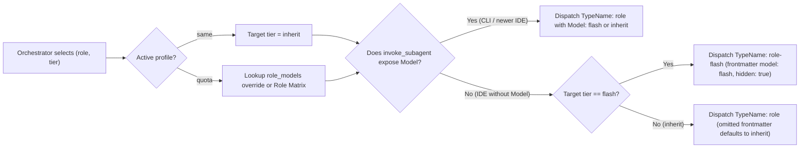

# Multi-Model Orchestrator Port — Design Spec

> Design specification to port the multi-model orchestration architecture into `roundpilot/superpowers-antigravity` (target release: `v7.0.0`, baseline `main` commit `a0977aa40921ad25a126a1a76d5f6d8627ddd00d` on top of `adc31f80fc2252f09b077604a483a4ead85ee554`). Written in ASD-STE100 for direct inclusion at `docs/superpowers/specs/2026-11-04-multimodel-orchestrator-design.md`.

## 1. Objective and Scope

`roundpilot/superpowers-antigravity` v6.3.0 ships four subagents (`implementer`, `spec-reviewer`, `code-reviewer`, `re-reviewer`). Each agent file sets `model: inherit`. Every subagent dispatch runs on the parent session model. When the user runs a frontier reasoning model, routine implementation and diff checks consume frontier quota and increase latency.

This specification ports the unified v7.0 multi-model orchestrator architecture into `superpowers-antigravity`:

1. **Always-On Adaptive Multi-Model Orchestrator:** Default `mode=auto` and `profile=quota` in `skills/using-superpowers/SKILL.md` and `rules/using-superpowers.md`.
2. **Hybrid Model-Resolution Layer:** Combines request-time `invoke_subagent(..., Model: "flash" | "inherit")` with `hidden: true` `-flash` subagent variants so quota routing works in both Antigravity CLI and Antigravity IDE.
3. **Expanded Specialist Roster (11 Primary Subagents + 8 Hidden Flash Variants + 1 Optional Main Agent):** Retains the 3-reviewer split (`spec-reviewer`, `code-reviewer`, `re-reviewer`) for upstream `obra/superpowers` skill parity and adds `architect`, `planner`, `verifier`, `codesigner`, `designdoc-drafter`, `skills-implementer`, and `skills-devils-advocate`.
4. **Best-of-N Tier 3 Topology and `[ROLE:]` Envelope:** Adds parallel candidate planning, parallel dual-tier code review, independent non-author verification, and hermetic `[ROLE: <role>]` handoff prompts.
5. **Quota Guardrails and Automatic Escalation:** Bans `Model: "pro"`, caps concurrent `inherit` dispatches at 2, escalates `implementer` from `flash` to `inherit` on `BLOCKED` or Fix Rounds 4–5, falls back from `inherit` to `flash` on `429` errors, and routes parallel execution shards in `dispatching-parallel-agents` to `flash` `implementer` instead of `self`.

### Non-Goals

- Cross-platform tool mapping layers. All files use native Antigravity 2.0 tool names only.
- Monorepo-internal tools or hosts (`code_search`, `moma_search`, internal build wrappers, or private swarm boards). Every subagent `tools:` entry must exist in Antigravity 2.0's documented 20-tool set.
- Replacing the two-stage `spec-reviewer` -> `code-reviewer` contract in `subagent-driven-development`.

---

## 2. Verified Antigravity 2.0 Runtime Constraints

Source inspection of the Antigravity Cortex runtime establishes three platform constraints that govern this design:

1. **Frontmatter `model:` Overrides Request-Time `Model`:** When an agent `.md` file sets `model: inherit` in YAML frontmatter, the parser assigns `MODEL_TIER_INHERIT` to the agent definition. During `invoke_subagent`, the handler checks the agent's frontmatter tier first and ignores `Model: "flash"` passed by the caller. Only when `model:` is **omitted** from frontmatter (`MODEL_TIER_UNSPECIFIED`) does `invoke_subagent` honor the caller's `Model` argument (defaulting to `"inherit"` if the caller also omits `Model`).
2. **CLI vs. IDE `Model` Schema Gap:** Antigravity CLI (`agy`) sets `always_inherit_model: false` on `invoke_subagent` and exposes `Model` (`"inherit" | "flash" | "flash_lite" | "pro"`). Some Antigravity IDE builds set `always_inherit_model: true` and omit `Model` from the `invoke_subagent` schema.
3. **`hidden: true` Subagent Frontmatter:** Antigravity `.md` agent frontmatter supports `hidden: true`. Hidden subagents do not clutter the `<subagents>` prompt list, yet `invoke_subagent` resolves them by exact `TypeName`.

> [!WARNING]
> Do not set `model: inherit` in any primary `agents/<role>.md` file. Leaving `model: inherit` in frontmatter silently defeats `invoke_subagent(..., Model: "flash")`.

---

## 3. Hybrid Model-Resolution Architecture



### Resolution Rules

1. If `profile == "same"`, set target tier to `"inherit"` for all roles (unless overridden in `role_models`).
2. If `profile == "quota"`, determine target tier from `.superpowers/config.json` -> `~/.gemini/superpowers_config.json` -> the canonical Role Routing Matrix (Section 5).
3. Inspect the active session's `invoke_subagent` tool declaration:
   - **If `Model` is declared on `invoke_subagent`:** Dispatch primary `TypeName: "<role>"` and pass `Model: "<tier>"` explicitly (`"flash"` or `"inherit"`). Match the session's `invoke_subagent` shape (`Subagents: [{...}]` array vs. flat arguments; `Subagents: [{...}]` remains canonical in skill examples).
   - **If `Model` is absent from `invoke_subagent`:**
     - If `<tier> == "inherit"`, dispatch `TypeName: "<role>"`. Because `agents/<role>.md` omits `model:`, Cortex resolves it to `inherit`.
     - If `<tier> == "flash"`, dispatch `TypeName: "<role>-flash"` (or `TypeName: "research-flash"` instead of built-in `research`). Because `agents/<role>-flash.md` sets `model: flash` and `hidden: true`, Cortex forces `flash` deterministically.

### Strict Quota Guardrails

1. **Ban `Model: "pro"`:** Never pass `Model: "pro"` in `invoke_subagent` and never set `model: pro` in bundled `agents/*.md`. Use only `"flash"` and `"inherit"` so the user's selected session model defines the reasoning ceiling.
2. **Concurrency Cap (`max_concurrent_inherit: 2`):** Never run more than 2 `"inherit"` subagents concurrently. If 3 tasks require `"inherit"`, batch them into waves of at most 2.
3. **`429` / Capacity Fallback:** If an `"inherit"` subagent fails with `429 RESOURCE_EXHAUSTED`, quota exhaustion, or capacity timeout, record `Ruling: <role> downgraded inherit -> flash due to 429/capacity — <risk if lower reasoning misses edge case>` in the ledger (or chat if no ledger is open) and retry immediately on `"flash"` (`TypeName: "<role>-flash"` if `Model` is absent, or `research-flash` if a judgment role has no dedicated `-flash` file).

---

## 4. Configuration Cascade and Activation

### Precedence Order (Highest to Lowest)

1. **Session Slash Command:** `/start-superpowers [auto|solo|subagents] [quota|same]` or `/start-superpowers-multimodel` (alias for `/start-superpowers subagents quota`).
2. **Workspace Config File:** `<repo-root>/.superpowers/config.json`.
3. **Global User Config File:** `~/.gemini/superpowers_config.json`.
4. **Built-in Default:** `mode = "auto"`, `profile = "quota"`, `max_concurrent_inherit = 2`.

### Config Schema (`.superpowers/config.json` & `~/.gemini/superpowers_config.json`)

```json
{
  "default_mode": "auto",
  "default_profile": "quota",
  "max_concurrent_inherit": 2,
  "role_models": {
    "implementer": "flash",
    "spec-reviewer": "flash",
    "code-reviewer": "flash",
    "code-reviewer-lead": "inherit",
    "re-reviewer": "flash",
    "planner": "flash",
    "planner-tier3": "inherit",
    "architect": "inherit",
    "verifier": "flash",
    "codesigner": "inherit",
    "designdoc-drafter": "flash",
    "skills-implementer": "inherit",
    "skills-devils-advocate": "inherit",
    "research": "flash"
  }
}
```

Valid values in `role_models` are `"flash"` and `"inherit"`. If a config file specifies `"pro"`, log a warning and coerce it to `"inherit"`.

---

## 5. Step-0 Adaptive Router and Role Matrix

### Host Yield and Leaf Worker Guard (`<SUBAGENT-STOP>`)

Before routing any turn:

1. **Leaf Rule (`<SUBAGENT-STOP>`):** If the incoming prompt starts with `[ROLE:` or `<SUBAGENT-STOP>`, or if `invoke_subagent` is absent from the active tool declarations, operate strictly as a **leaf worker**. Execute the assigned task directly. Do not read orchestrator routing rules and do not spawn subagents.
2. **Host Yield:** If the prompt or system context invokes `/teamwork-preview` (`<TEAMWORK>`) or `/browser` (`<SUBAGENT>`), yield to that built-in host. Apply Superpowers TDD, debugging, and verification skills as leaf discipline without running a competing Step-0 router or wrapping built-in host calls in `[ROLE:]` envelopes.

### Step-0 Routes (First Match Wins)

On the first response to a new engineering task, announce one line:
`Route: <N> (<mode>) — <reason> [Profile: <quota|same>]`

| Route | Trigger Condition | Execution Topology (`quota` profile) |
|---|---|---|
| **Route 0: Explicit Override** | User invokes `/start-superpowers [mode] [profile]`, `/start-superpowers-multimodel`, or explicitly asks to spawn subagents. | Apply requested `mode` and `profile`. If `mode=subagents` or user requested subagents, bypass Route 1. |
| **Route 1: Tier 1 Surgical (Direct IC)** | `mode` is `auto` or `solo`, and task is read-only Q&A, lookup, or surgical edit (`<= 2` coupled files, `< 150` lines, known cause). | Execute directly in main context (after `brainstorming` bounded approval if creative/behavioral). Run project tests directly. Escalate to Route 4 if `> 2` files change or tests fail. *(If `mode=subagents`, dispatch `1x implementer` on `flash`.)* |
| **Route 2: Open Survey (`9+` Files)** | Broad codebase exploration across `9+` files or unfamiliar architecture. | Dispatch `1x architect` (`inherit`) + sharded `research` (`flash` / `research-flash`, max 10 files or 150 KB per shard). |
| **Route 3: Persistent Bug (`>= 2` Failed Fixes)** | Bug survives `>= 2` fix attempts or involves race/state corruption. | Follow `systematic-debugging` Phase 1. Dispatch `implementer` (`flash` on attempt 1; escalate to `inherit` if a `flash` implementer already failed). |
| **Route 4: Tier 2 Coupled Feature (`3–8` Files)** | Settled design touching `3–8` coupled files. | `1x planner` (`flash`, if no plan exists) -> per-task `1x implementer` (`flash`) -> `1x spec-reviewer` (`flash`) -> `1x code-reviewer` (`flash`) -> whole-branch `1x code-reviewer` (`inherit`) + `1x verifier` (`flash`). |
| **Route 5: Tier 3 Architectural / Cross-Package** | Cross-package refactor, interface/schema migration, or security-critical change. | **Best-of-N:** `1x architect` (`inherit`) -> `2x planner` (`inherit`, parallel) -> synthesize unified plan -> per-task `1x implementer` (`flash`, max 3 tasks or 8 files per batch) -> `1x spec-reviewer` (`flash`) -> parallel `2x code-reviewer` (`1x inherit` lead + `1x flash` secondary) -> `1x verifier` (`flash`). |
| **Route 6: Disjoint Parallel Domains (`3+` Slices)** | `3+` independent test failures, subsystems, or mechanical file shards with zero shared state. | Use `dispatching-parallel-agents`: dispatch `implementer` (`flash` / `implementer-flash`) per slice with `Workspace: "share"` -> `1x verifier` (`flash`) on merged result. For multi-milestone autonomous campaigns, offer `/teamwork-preview` after explicit user approval. |
| **Route 7: Human-Gated Design, Plan, or Skill** | Underspecified feature, `/design`, `/plan`, or `writing-skills` request. | **Design:** foreground Q&A + `generate_image` in main context -> `1x codesigner` (`inherit`) critique & handoff transcript -> `1x designdoc-drafter` (`flash`) drafts spec -> user review gate. **Plan:** Tier 2 `1x planner` (`flash`) or Tier 3 `architect` + `2x planner` (`inherit`). **Skills:** `1x skills-implementer` (`inherit`) -> `1x skills-devils-advocate` (`inherit`). |

### Canonical Role Routing Matrix

| Subagent `TypeName` | IDE Flash Variant (`hidden: true`) | `quota` Tier | `same` Tier | `Workspace` | Mutates Repo? |
|---|---|---|---|---|---|
| `architect` | *(uses `research-flash` on 429)* | `inherit` | `inherit` | `"inherit"` | No (read-only) |
| `codesigner` | *(foreground fallback on 429)* | `inherit` | `inherit` | `"inherit"` | Writes `.superpowers/designs/` handoff only |
| `designdoc-drafter` | `designdoc-drafter-flash` | `flash` | `inherit` | `"inherit"` | Writes `docs/superpowers/specs/` only |
| `planner` | `planner-flash` | Tier 2: `flash` · Tier 3 / `/plan`: `inherit` | `inherit` | `"inherit"` | Writes `docs/superpowers/plans/` or scratch plan |
| `implementer` | `implementer-flash` | Rounds 1–3: `flash` · `BLOCKED` / Rounds 4–5: `inherit` | `inherit` | `"branch"` (SDD) / `"share"` (parallel disjoint) | Yes |
| `spec-reviewer` | `spec-reviewer-flash` | `flash` | `inherit` | `"inherit"` | No (read-only) |
| `code-reviewer` | `code-reviewer-flash` | Tier 2 task & Tier 3 secondary: `flash` · Tier 3 lead & final branch: `inherit` | `inherit` | `"inherit"` | No (read-only) |
| `re-reviewer` | `re-reviewer-flash` | `flash` | `inherit` | `"inherit"` | No (read-only) |
| `verifier` | `verifier-flash` | `flash` | `inherit` | `"inherit"` | No (runs tests/lints read-only) |
| `skills-implementer` | *(foreground fallback on 429)* | `inherit` | `inherit` | `"branch"` | Yes (`skills/`, tests) |
| `skills-devils-advocate` | *(uses `code-reviewer-flash` on 429)* | `inherit` | `inherit` | `"inherit"` | No (read-only) |
| `research` *(built-in)* | `research-flash` | `flash` | `inherit` | `"inherit"` | No (read-only) |

---

## 6. Hermetic Handoff Envelope, Synthesis, and Escalation Protocols

### 6.1 `[ROLE: <role>]` Handoff Envelope

Every `invoke_subagent` prompt to a bundled specialist (or `self` fallback) MUST begin with this envelope:

```markdown
[ROLE: <role-name>]
<SUBAGENT-STOP>
GOAL: <one-sentence engineering objective>
TASK: <full self-contained task text, commit range, or audit brief — never make the subagent read the plan file>
SCOPE: <exact file paths owned or inspected by this subagent>
CONTEXT: <Global Constraints from spec/plan, interface contracts, relevant ledger rulings>
CONSTRAINTS: Workspace=<inherit|branch|share>; leaf worker only (never invoke subagents); read <= 10 files / <= 150 KB per turn
VERIFICATION: <exact project test/lint commands or read-only inspection rules>
SKILLS: <optional workspace/plugin paths to leaf SKILL.md files such as test-driven-development or systematic-debugging>
```

> [!IMPORTANT]
> Never pass orchestrator coordination skills (`using-superpowers`, `subagent-driven-development`, `executing-plans`, `dispatching-parallel-agents`, `finishing-a-development-branch`, `brainstorming`) inside a leaf subagent's `SKILLS:` field.

### 6.2 Tier 3 Best-of-N Synthesis Protocol

1. **Parallel Planning (`2x planner` on `inherit`):** Instruct each candidate planner to write its draft to its own `<appDataDir>/brain/<own-conversation-id>/scratch/candidate-plan.md` and return an executive summary + task/file index table via `send_message`. Never let two parallel planners write to the same repository path. The orchestrator compares trade-offs, cherry-picks the strongest edge-case and test coverage, writes a single canonical plan to `docs/superpowers/plans/YYYY-MM-DD-<topic>.md`, and passes only that canonical plan's tasks to `implementer`.
2. **Parallel Review (`2x code-reviewer`: `1x inherit` lead + `1x flash` secondary):** Run after `spec-reviewer` (`flash`) passes. Assign the `inherit` lead reviewer to architecture, cross-module contracts, and plan alignment. Assign the `flash` secondary reviewer to security, error handling, test adequacy, and edge cases. Deduplicate overlapping findings, rank `Critical -> Important -> Minor`, and feed the merged list into the Fix Loop.
3. **Non-Author Verification Gate (`verifier` on `flash`):** `implementer` may never declare the overall plan verified. After the final whole-branch `code-reviewer` (`inherit`) approves, dispatch `verifier` (`flash`) to execute the full affected test suite, check `git status --porcelain`, and confirm exit code `0` empirically before invoking `finishing-a-development-branch`.

### 6.3 5-Round Fix Loop and `BLOCKED` Escalation

1. **Rounds 1–3 (`flash` Resume):** Send open findings via `send_message` to the existing `implementer` (`flash`) conversation. Verify each round with `re-reviewer` (`flash`).
2. **Rounds 4–5 (`inherit` Takeover Escalation):** If Round 3 fails to clear all `Critical`/`Important` or spec findings, terminate the `flash` implementer via `manage_subagents(Action: "kill", ConversationIds: ["<id>"])`. Spawn a fresh `implementer` on **`inherit`** (`TypeName: "implementer"`, `Model: "inherit"`, `Workspace: "branch"`). Instruct it to run `git checkout <task-branch>` first and pass the task text, prior report, and open findings. If Round 4 still leaves open findings, resume that `inherit` implementer via `send_message` for Round 5.
3. **`BLOCKED` Reasoning Escalation:** If a `flash` `implementer` returns `STATUS: BLOCKED` due to design ambiguity or multi-file complexity (rather than missing context), kill it and re-dispatch `implementer` on **`inherit`** with any needed architectural ruling recorded in the ledger. Remove all instructions telling the controller to manually edit `.agents/agents/<name>.md` to `model: pro`.
4. **Round 5 Cap:** Adjudicate remaining findings in `.superpowers/sdd/<plan-basename>/progress.md` per existing `subagent-driven-development` rules (`Contested`, `Real but not load-bearing`, `Real and load-bearing`).

### 6.4 3-Phase Missing-Subagent Fallback (`references/fallback-adapter.md`)

If `invoke_subagent` fails with `"subagent not found or not allowed"` (for example, in an IDE session where plugin `agents/` discovery did not fire):

1. **Phase 1 (`define_subagent`):** Read the bundled `agents/<role>.md` body, strip YAML frontmatter, and call `define_subagent` matching the session's active schema (`{Name: "<role>", Description: "<desc>", SystemPrompt: "<body>", EnableWriteTools: <bool>, EnableMCPTools: false, EnableSubagentTools: false}` in current Cortex/CLI, or snake_case `{name: "<role>", description: "<desc>", system_prompt: "<body>", enable_write_tools: <bool>, enable_mcp_tools: false, enable_subagent_tools: false}` in older builds). Then retry `invoke_subagent` (passing `Model: "<tier>"` if `Model` is supported). *Note:* `verifier` requires `run_command`; if the host gates `run_command` behind `EnableWriteTools: true` / `enable_write_tools: true`, set it to `true` while keeping `verifier`'s read-only prompt mandate.
2. **Phase 2 (`TypeName: "self"` Leaf Override):** If `define_subagent` fails, call `invoke_subagent` with `TypeName: "self"`, `Role: "<role>"`, `Model: "<tier>"` (if `Model` is supported; always `"flash"` for execution roles in `quota`), and prepend `<SUBAGENT-STOP>` + the contents of `agents/<role>.md` to the `[ROLE: <role>]` envelope.
3. **Phase 3 (Inline Leaf Execution):** If `invoke_subagent` itself is unavailable, read `agents/<role>.md` and execute the stages sequentially in the current context with full verification gates.

---

## 7. File-by-File Specification

### 7.1 Repository Layout Changes

```text
superpowers-antigravity/
├── plugin.json                                      # MODIFIED: bump version to 7.0.0, update description
├── gemini-extension.json                            # MODIFIED: bump version to 7.0.0, update description
├── README.md                                        # MODIFIED: document quota/same profiles, Step-0 router, 11 roles
├── rules/
│   └── using-superpowers.md                         # MODIFIED: byte-identical mirror of skills/using-superpowers/SKILL.md
├── references/
│   └── fallback-adapter.md                          # NEW: 3-phase define_subagent -> self -> inline adapter
├── agents/
│   ├── superpowers-multimodel.md                    # NEW: optional mainAgent: true, subagent: false orchestrator entry
│   ├── implementer.md                               # MODIFIED: omit model:, add [ROLE:]/<SUBAGENT-STOP> handling
│   ├── implementer-flash.md                         # NEW: model: flash, hidden: true mirror of implementer.md
│   ├── spec-reviewer.md                             # MODIFIED: omit model:
│   ├── spec-reviewer-flash.md                       # NEW: model: flash, hidden: true mirror of spec-reviewer.md
│   ├── code-reviewer.md                             # MODIFIED: omit model:
│   ├── code-reviewer-flash.md                       # NEW: model: flash, hidden: true mirror of code-reviewer.md
│   ├── re-reviewer.md                               # MODIFIED: omit model:
│   ├── re-reviewer-flash.md                         # NEW: model: flash, hidden: true mirror of re-reviewer.md
│   ├── architect.md                                 # NEW: omitted model:, read-only system architect
│   ├── planner.md                                   # NEW: omitted model:, bite-sized TDD plan architect
│   ├── planner-flash.md                             # NEW: model: flash, hidden: true mirror of planner.md
│   ├── verifier.md                                  # NEW: omitted model:, independent test & hygiene verifier
│   ├── verifier-flash.md                            # NEW: model: flash, hidden: true mirror of verifier.md
│   ├── codesigner.md                                # NEW: omitted model:, adversarial design critic & handoff writer
│   ├── designdoc-drafter.md                         # NEW: omitted model:, grounded spec drafter
│   ├── designdoc-drafter-flash.md                   # NEW: model: flash, hidden: true mirror of designdoc-drafter.md
│   ├── skills-implementer.md                        # NEW: omitted model:, TDD skill engineer
│   ├── skills-devils-advocate.md                    # NEW: omitted model:, read-only CSO & loophole skill auditor
│   └── research-flash.md                            # NEW: model: flash, hidden: true read-only shard explorer
├── skills/
│   ├── using-superpowers/SKILL.md                   # MODIFIED: Step-0 router, quota/same matrix, hybrid Model resolution
│   ├── start-superpowers/SKILL.md                   # NEW: runtime mode/profile switch (/start-superpowers)
│   ├── start-superpowers-multimodel/SKILL.md        # NEW: alias setting mode=subagents, profile=quota
│   ├── subagent-driven-development/SKILL.md         # MODIFIED: automatic flash/inherit routing, Tier 3 Best-of-N, verifier gate
│   ├── dispatching-parallel-agents/SKILL.md         # MODIFIED: replace self with flash implementer + verifier
│   ├── brainstorming/SKILL.md                       # MODIFIED: architectural path delegates critique/drafting to codesigner + designdoc-drafter
│   ├── writing-plans/SKILL.md                       # MODIFIED: delegate plan authoring to planner (1x flash Tier 2 / 2x inherit Tier 3)
│   ├── requesting-code-review/SKILL.md              # MODIFIED: route task review to flash and whole-branch review to inherit
│   ├── writing-skills/SKILL.md                      # MODIFIED: route skill build + audit to skills-implementer -> skills-devils-advocate
│   └── diagnosing-superpowers/                      # MODIFIED: wire analysts/scrub-audit/similar-session to verifier-flash, scrub to implementer-flash, fix templates/issue.md purity
├── docs/superpowers/specs/
│   ├── 2026-07-29-antigravity-2-0-platform-reference.md # MODIFIED: document frontmatter model precedence, hidden: true, CLI vs IDE Model param
│   └── 2026-11-04-multimodel-orchestrator-design.md     # NEW: this specification
└── tests/antigravity/
    ├── test-agent-frontmatter.sh                    # MODIFIED: enforce omitted model on primaries, model: flash + hidden: true on *-flash.md
    └── test-multimodel-routing.sh                   # NEW: static checks for mirror parity, no Model:"pro", [ROLE:] envelope, config schema
```

### 7.2 Exact Agent Frontmatter Contracts (`agents/*.md`)

Every tool name in `tools:` MUST come strictly from `KNOWN_TOOLS` in `tests/antigravity/test-agent-frontmatter.sh`:
`view_file`, `write_to_file`, `replace_file_content`, `multi_replace_file_content`, `list_dir`, `find_by_name`, `grep_search`, `search_web`, `read_url_content`, `run_command`, `manage_task`, `schedule`, `list_permissions`, `ask_permission`, `invoke_subagent`, `define_subagent`, `send_message`, `manage_subagents`, `ask_question`, `generate_image`.

#### A. Existing Primary Subagents (Modify Frontmatter + Add Leaf Header)

Remove `model: inherit` from `implementer.md`, `spec-reviewer.md`, `code-reviewer.md`, and `re-reviewer.md`. Prepend a short leaf-envelope note (`Accepts [ROLE: <name>] envelopes; never spawn subagents.`) to each body while preserving all v6.3.0 review/implementation rules verbatim.

#### B. New Primary Specialist Subagents (Omit `model:`)

1. **`agents/architect.md`**
   - Frontmatter: `name: architect`, `subagent: true`, `mainAgent: false`, `tools: [view_file, list_dir, find_by_name, grep_search, search_web, read_url_content, run_command, send_message]`
   - System Prompt Contract: Read-only boundary and blast-radius analyst. Reads nearest `AGENTS.md`/`CONTRIBUTING.md`/`README.md` first. Enforces Corpus Sharding (`<= 10` files / `<= 150 KB` per turn) and Pre-Write Grounding (verifies every cited path/symbol via `find_by_name`, `grep_search`, or `view_file`). Returns `STATUS: DONE | DONE_WITH_CONCERNS | NEEDS_CONTEXT | BLOCKED` with `Architectural Summary`, `Blast Radius & Invariants` (clickable `file:///` links), `Trade-offs & Rejected Alternatives`, and `Handoff Guidance for Planner`.

2. **`agents/planner.md`**
   - Frontmatter: `name: planner`, `subagent: true`, `mainAgent: false`, `tools: [view_file, write_to_file, list_dir, find_by_name, grep_search, search_web, read_url_content, send_message]`
   - System Prompt Contract: Decomposes approved designs/specs into bite-sized TDD tasks (`2–5` minutes per step) matching `skills/writing-plans/SKILL.md` (`Goal`, `Architecture`, `Mermaid` diagram, `Tech Stack`, `Spec` pointer, `Global Constraints`, per-task `Files`, `Interfaces`, `- [ ]` RED-GREEN-COMMIT steps, zero `TODO`/`TBD` placeholders). Verifies every file path before writing. Writes either to `docs/superpowers/plans/YYYY-MM-DD-<topic>.md` (Tier 2) or `<appDataDir>/brain/<own-conversation-id>/scratch/candidate-plan.md` (Tier 3 Best-of-N) as instructed in `TASK`. Returns `STATUS`, `Plan Overview & Task DAG`, `Plan Location`, and `Verification Commands`.

3. **`agents/verifier.md`**
   - Frontmatter: `name: verifier`, `subagent: true`, `mainAgent: false`, `tools: [view_file, list_dir, find_by_name, grep_search, run_command, manage_task, schedule, send_message]`
   - System Prompt Contract: Read-only QA gatekeeper enforcing `verification-before-completion`. Never trusts `implementer` or `code-reviewer` test claims. Runs project test suites and linters (`--dry-run` / check mode only; never mutates files or commits), checks `git status --porcelain` for stray untracked files, and returns `STATUS: VERIFIED | FAILED | BLOCKED` with exact commands run, exit codes, pass/fail counts, and actionable failure snippets.

4. **`agents/codesigner.md`**
   - Frontmatter: `name: codesigner`, `subagent: true`, `mainAgent: false`, `tools: [view_file, write_to_file, list_dir, find_by_name, grep_search, search_web, read_url_content, send_message]`
   - System Prompt Contract: Adversarial design reviewer invoked after foreground `brainstorming` Q&A converges. Grounds proposed interfaces against live repo files (`<= 10` files / `<= 150 KB` per turn), challenges unexamined assumptions or YAGNI violations, and writes the structured design record to `<repo-root>/.superpowers/designs/<slug>-handoff.md` (ensuring `.superpowers/.gitignore` contains `*`). Returns `STATUS`, `Summary` (including any flaws caught), `Artifacts` (handoff path), and `NextSteps` for `designdoc-drafter`.

5. **`agents/designdoc-drafter.md`**
   - Frontmatter: `name: designdoc-drafter`, `subagent: true`, `mainAgent: false`, `tools: [view_file, write_to_file, replace_file_content, list_dir, find_by_name, grep_search, send_message]`
   - System Prompt Contract: Transforms `.superpowers/designs/<slug>-handoff.md` into `docs/superpowers/specs/YYYY-MM-DD-<topic>-design.md` without deleting the handoff file. Spot-checks only unconfirmed file paths/symbols, writes crisp architecture prose + cycle-free Mermaid diagrams + verification plan, runs the 4-point spec self-review (placeholders, consistency, scope, ambiguity), and returns `STATUS`, `Summary`, and `Artifacts`.

6. **`agents/skills-implementer.md`**
   - Frontmatter: `name: skills-implementer`, `subagent: true`, `mainAgent: false`, `tools: [view_file, write_to_file, replace_file_content, multi_replace_file_content, list_dir, find_by_name, grep_search, run_command, send_message]`
   - System Prompt Contract: Authors or updates `SKILL.md` and companion tests following `skills/writing-skills/SKILL.md`. Enforces CSO frontmatter (`name` + `description` only, `< 1024` chars, `Use when...` triggers only, zero workflow summaries in `description`), Antigravity tool purity (never banned legacy tool/platform names), and structural test execution (`test-skill-tool-purity.sh`, `test-rule-sync.sh`).

7. **`agents/skills-devils-advocate.md`**
   - Frontmatter: `name: skills-devils-advocate`, `subagent: true`, `mainAgent: false`, `tools: [view_file, list_dir, find_by_name, grep_search, run_command, send_message]`
   - System Prompt Contract: Read-only adversarial skill auditor. Spot-checks every tool name, argument name, and file path against `docs/superpowers/specs/2026-07-29-antigravity-2-0-platform-reference.md` and the live repo. Flags workflow leaks in `description`, rationalization loopholes in discipline skills, and purity/sync violations. Returns `Audit Verdict: APPROVED | CHANGES_REQUESTED` with `[CRITICAL]` / `[IMPORTANT]` / `[MINOR]` findings and `file:line` evidence.

8. **`agents/research-flash.md`**
   - Frontmatter: `name: research-flash`, `subagent: true`, `mainAgent: false`, `hidden: true`, `model: flash`, `tools: [view_file, list_dir, find_by_name, grep_search, search_web, read_url_content, send_message]`
   - System Prompt Contract: Read-only codebase and web research worker (`<= 10` files / `<= 150 KB` per turn) used when `profile=quota` runs on an IDE build without `invoke_subagent(Model:)` (since built-in `research` inherits the parent model when `Model` cannot be passed).

9. **`agents/superpowers-multimodel.md`**
   - Frontmatter: `name: superpowers-multimodel`, `description: "Adaptive multi-model Superpowers orchestrator (profile=quota, mode=subagents)."`, `mainAgent: true`, `subagent: false` (omit `model:` and omit `tools:` so Cortex injects `DefaultTools` + `SectionSubagents`).
   - System Prompt Body: Sets session defaults `mode=subagents`, `profile=quota` and instructs the agent to follow `skills/using-superpowers/SKILL.md`.

#### C. Hidden `-flash` Mirror Variants

Create these seven additional `hidden: true`, `model: flash`, `subagent: true`, `mainAgent: false` files whose Markdown prompt bodies and `tools:` lists are **byte-identical** to their primary counterparts:
- `agents/implementer-flash.md` (mirrors `agents/implementer.md`)
- `agents/spec-reviewer-flash.md` (mirrors `agents/spec-reviewer.md`)
- `agents/code-reviewer-flash.md` (mirrors `agents/code-reviewer.md`)
- `agents/re-reviewer-flash.md` (mirrors `agents/re-reviewer.md`)
- `agents/planner-flash.md` (mirrors `agents/planner.md`)
- `agents/verifier-flash.md` (mirrors `agents/verifier.md`)
- `agents/designdoc-drafter-flash.md` (mirrors `agents/designdoc-drafter.md`)

### 7.3 Rules and Skills Changes

> [!CAUTION]
> **Two Repository-Wide Static Gate Traps:**
> 1. **`tests/antigravity/test-skill-tool-purity.sh` & `hooks/purity-check.sh`:** Never write any banned token (`TodoWrite`, `EnterWorktree`, `Task tool`, `Skill tool`, `Claude Code`, `Codex CLI`, `Codex App`, `Copilot CLI`, `OpenCode`, `Factory Droid`, `Gemini CLI`, `antigravity-tools`, `copilot-tools`, `codex-tools`, `gemini-tools`) anywhere inside `skills/`.
> 2. **`tests/antigravity/test-rule-sync.sh` Line 39 (`grep -n -- '-->' "$RULE_FILE" | tail -1`):** `test-rule-sync.sh` finds the end of `rules/using-superpowers.md`'s header comment by matching the **last** `-->` in the entire file! Therefore, `skills/using-superpowers/SKILL.md` and `rules/using-superpowers.md` MUST NOT contain the three-character sequence `-->` anywhere in their body (use Unicode `→` in prose/tables and Graphviz `->` if needed, never Mermaid `-->` or HTML comments).

1. **`skills/using-superpowers/SKILL.md` & `rules/using-superpowers.md`:**
   - Keep `<SUBAGENT-STOP>` at the top, updated to also trigger when the prompt starts with `[ROLE:` or when `invoke_subagent` is absent.
   - Keep `<EXTREMELY-IMPORTANT>`, `## The Rule`, `## Skill Priority`, `## Red Flags`, and `## User Instructions`.
   - Add concise sections (using `→`, never `-->`) for:
     - `## Step-0 Adaptive Router & Host Yield` (Routes 0–7, `Route: <N> (<mode>) — <reason> [Profile: <quota|same>]` announcement, `/teamwork-preview` & `/browser` yield).
     - `## Multi-Model Routing (quota vs same)` (config cascade `.superpowers/config.json` → `~/.gemini/superpowers_config.json`, Role Routing Matrix, Hybrid `Model` / `-flash` resolution rule, ban on `Model: "pro"`, max 2 concurrent `inherit`, `429` fallback to `flash`, `[ROLE: <role>]` handoff envelope, and pointer to `references/fallback-adapter.md`).
   - Copy the body from the first line after YAML frontmatter into `rules/using-superpowers.md` after its header comment so `test-rule-sync.sh` passes with zero diff.

2. **`skills/start-superpowers/SKILL.md` & `skills/start-superpowers-multimodel/SKILL.md`:**
   - `start-superpowers`: CSO `description: "Use when switching Superpowers orchestration mode (auto, solo, subagents) or model-routing profile (quota, same) for the current session"`. Parses optional `[auto|solo|subagents]` and `[quota|same]` arguments (defaulting to `auto` + `quota`), confirms active settings in one sentence, and applies `using-superpowers`.
   - `start-superpowers-multimodel`: CSO `description: "Use when activating strict 100% delegated multi-model orchestration (/start-superpowers-multimodel) with quota-saving flash execution and inherited reasoning"`. Sets `mode=subagents` and `profile=quota` (bypassing Route 1 Direct IC).

3. **`skills/subagent-driven-development/SKILL.md`:**
   - Replace `## Model Selection` (lines 165–181, which currently claim `invoke_subagent` never takes `Model` and instruct manual `.agents/agents/` file edits) with automatic `quota`/`same` routing using the Hybrid Resolution Rule (`Model: "flash" | "inherit"` when `Model` is in `invoke_subagent`, or `<role>-flash` / `<role>` when `Model` is absent).
   - Update `### The Task Loop` to wrap dispatches in `[ROLE: <role>]` envelopes, route per-task `implementer`, `spec-reviewer`, `code-reviewer`, and `re-reviewer` to `flash` in `quota` profile, and route the final whole-branch `code-reviewer` to `inherit` followed by `verifier` (`flash`) before `finishing-a-development-branch`.
   - Add `### Tier 3 Best-of-N Mode`: when the plan header or Route 5 marks a plan as Tier 3 Architectural, run parallel `2x code-reviewer` (`1x inherit` lead + `1x flash` secondary) after `spec-reviewer` (`flash`), synthesize findings, and require `verifier` (`flash`) pass at completion.
   - Update `### Handling Implementer Status` (`BLOCKED`, line 215) and `### The Fix Loop` (`Rounds 4–5`, lines 280–287) to automatically escalate `implementer` from `flash` to `inherit` (never `pro`).

4. **`skills/dispatching-parallel-agents/SKILL.md`:**
   - Replace `TypeName: "self"` in parallel fix/execution examples with `TypeName: "implementer"` routed to `flash` (`Model: "flash"` or `TypeName: "implementer-flash"` on IDE without `Model`) and `Workspace: "share"` for disjoint file edits, or `research` (`flash` / `research-flash`) with `Workspace: "inherit"` for read-only investigations.
   - Enforce the `max_concurrent_inherit: 2` cap if any shard is explicitly escalated to `inherit`, and dispatch `1x verifier` (`flash`) during `### 4. Review and Integrate` to run the full test suite.

5. **`skills/brainstorming/SKILL.md`:**
   - Keep `Spike` and `Bounded` paths inline in main context (using `research` on `flash` / `research-flash` only when broad lookup is needed).
   - On the `Architectural` path:
     - Step 1 (`Explore project context`): route parallel `research` dispatches to `flash` (`Model: "flash"` or `research-flash`), or `1x architect` (`inherit`) when cross-package boundaries are unclear.
     - Steps 2–5 (`Assess visual needs`, `Ask clarifying questions`, `Propose 2–3 approaches`, `Present design`): keep interactive `ask_question` and `generate_image` in main context.
     - Step 6 (`Write design doc`): dispatch `1x codesigner` (`inherit`) to audit the agreed design against live repo symbols and write `.superpowers/designs/<slug>-handoff.md`, then dispatch `1x designdoc-drafter` (`flash` / `designdoc-drafter-flash`) to draft `docs/superpowers/specs/YYYY-MM-DD-<topic>-design.md`. Present the written spec with `RequestFeedback: true` for Step 8 (`User reviews written spec`).

6. **`skills/writing-plans/SKILL.md`:**
   - Add `**Tier:** [Tier 2 Coupled | Tier 3 Architectural]` to `## Plan Document Header` right after `**Spec:**`.
   - Delegate plan generation instead of authoring large plans in main context:
     - **Tier 2 (`3–8` coupled files):** Dispatch `1x planner` on `flash` (`planner-flash` on IDE without `Model`) to write `docs/superpowers/plans/YYYY-MM-DD-<feature-name>.md`.
     - **Tier 3 (Cross-package / Architectural):** Dispatch `1x architect` (`inherit`, if no architectural boundary map exists yet) followed by `2x planner` (`inherit`, parallel, capped at 2) writing candidate plans to their own scratch directories; synthesize the unified canonical plan at `docs/superpowers/plans/YYYY-MM-DD-<feature-name>.md` in main context with `RequestFeedback: true`.

7. **`skills/requesting-code-review/SKILL.md`:**
   - Specify tier selection under `profile=quota`: `flash` (`code-reviewer-flash` on IDE without `Model`) for single-task reviews; `inherit` (`code-reviewer`) for major-feature, pre-merge whole-branch, and Tier 3 lead reviews; `flash` (`research` / `research-flash`) for lightweight ad-hoc checks.

8. **`skills/writing-skills/SKILL.md`:**
   - Add a `## Delegated Skill Engineering Pipeline` section: dispatch `1x skills-implementer` (`inherit`, `Workspace: "branch"`) to run RED/GREEN micro-tests and author/edit `SKILL.md`, followed by `1x skills-devils-advocate` (`inherit`, `Workspace: "inherit"`) to audit CSO triggers, tool purity, and rationalization loopholes before completion.

9. **`skills/diagnosing-superpowers/SKILL.md` & `skills/diagnosing-superpowers/templates/issue.md`:**
   - Replace banned legacy platform phrasing (`Claude Code, Cursor, etc.`) in `templates/issue.md` line 24 with `Antigravity CLI, Antigravity IDE, etc.` so `test-skill-tool-purity.sh` passes.
   - Route the 7 parallel read-only dimension analysts (Step 3), `scrub-audit` (Step 6), and `similar-session` (Step 7) to `verifier` on `flash` (`Model: "flash"` or `verifier-flash`, `Workspace: "inherit"`), and route `scrub` (Step 6) to `implementer` on `flash` (`Model: "flash"` or `implementer-flash`, `Workspace: "inherit"`), preserving `tests/diagnosing-superpowers/test-skill-structure.sh` invariants (`<= 1000` words, `"your human partner"` phrasing).

10. **`docs/superpowers/specs/2026-07-29-antigravity-2-0-platform-reference.md`:**
   - Update `## Agent collaboration` and `## Custom subagents (.md)` to record:
     - Both `invoke_subagent` call shapes (flat `{TypeName, Role, Prompt, Model?, Workspace?}` and array `Subagents: [{Prompt, Role, TypeName, Model?, Workspace?}]`) and both `define_subagent` parameter casings (PascalCase `{Name, Description, SystemPrompt, EnableWriteTools?, EnableMCPTools?, EnableSubagentTools?}` and snake_case `{name, description, system_prompt, enable_write_tools?, ...}`).
     - `hidden` (`boolean`) in `.md` frontmatter.
     - Frontmatter `model:` precedence: explicit `model:` in `.md` frontmatter (`MODEL_TIER_INHERIT`) overrides request-time `invoke_subagent(Model:)`; omitting `model:` (`MODEL_TIER_UNSPECIFIED`) delegates tier selection to `invoke_subagent(Model:)` and defaults to `inherit`.
     - Surface split: Antigravity CLI (`always_inherit_model: false`) exposes `Model` (`inherit|flash_lite|flash|pro`) on `invoke_subagent`, whereas IDE builds with `always_inherit_model: true` omit `Model` and rely on `-flash` frontmatter variants.

---

## 8. Verification and Test Suite Specification

### 8.1 Update `tests/antigravity/test-agent-frontmatter.sh`

Replace the single `case "$model" in inherit|flash|pro)` check (line 35) with three mode-aware rules:

1. **`*-flash.md` files:** MUST declare `model: flash`, `hidden: true`, `subagent: true`, and `mainAgent: false`. Fail if `model` is anything other than `flash` or if `hidden: true` is missing.
2. **`superpowers-multimodel.md`:** MUST declare `mainAgent: true`, `subagent: false`, and MUST omit `model:`.
3. **All 11 primary subagent files (`implementer.md`, `spec-reviewer.md`, `code-reviewer.md`, `re-reviewer.md`, `architect.md`, `planner.md`, `verifier.md`, `codesigner.md`, `designdoc-drafter.md`, `skills-implementer.md`, `skills-devils-advocate.md`):** MUST declare `subagent: true`, `mainAgent: false`, and MUST **omit** `model:` (`[ -z "$model" ]`) so `MODEL_TIER_INHERIT` never overrides `invoke_subagent(Model: "flash")`. Fail on `model: pro` anywhere in `agents/*.md`.
4. Keep the existing `KNOWN_TOOLS` allowlist check across all 20 `agents/*.md` files.

### 8.2 Add `tests/antigravity/test-multimodel-routing.sh` (Static, Zero `agy` Required)

Create an automated bash test script verifying five invariants:

1. **Primary / `-flash` Mirror Parity:** For each of the 7 mirrored pairs (`implementer`, `spec-reviewer`, `code-reviewer`, `re-reviewer`, `planner`, `verifier`, `designdoc-drafter`), assert that:
   - Everything after the closing `---` frontmatter line is **byte-identical** (`diff -u`) between `<role>.md` and `<role>-flash.md`.
   - The extracted `tools:` list is **identical** between `<role>.md` and `<role>-flash.md`.
2. **Zero `Model: "pro"` Enforcement:** `grep -rnE 'Model:[[:space:]]*"pro"|^model:[[:space:]]*pro' agents/ skills/ rules/ references/` returns zero matches.
3. **Rule Sync & `-->` Safety Check:** Assert `rules/using-superpowers.md` contains zero `-->` lines after its header comment closer, and invoke `bash tests/antigravity/test-rule-sync.sh`.
4. **Envelope & Fallback Presence:** Assert `[ROLE:` and `<SUBAGENT-STOP>` appear in `skills/using-superpowers/SKILL.md`, `skills/subagent-driven-development/SKILL.md`, and `references/fallback-adapter.md`.
5. **Purity Gate Pass:** Invoke `bash tests/antigravity/test-skill-tool-purity.sh` across all new and modified skills.

### 8.3 Update `tests/antigravity/test-subagent-dispatch.sh` (Live `agy` Integration)

Add two transcript assertions after existing Test 1 (`invoke_subagent` called):

1. Verify that `implementer` (or `implementer-flash`) was dispatched with `Model: "flash"` when `agy` CLI exposes `Model` in the transcript.
2. Verify that `verifier` (or `verifier-flash`) ran before completion when executing under the updated `subagent-driven-development` workflow.

---

## 9. Recorded Divergences from Source Repositories

| Area | Upstream `gpowers` (`jetski_beta/`) | `superpowers-antigravity` Target Spec | Rationale |
|---|---|---|---|
| **Reviewer roles** | Consolidated single-pass `gpowers-reviewer` | Retains `spec-reviewer`, `code-reviewer`, and `re-reviewer` | Preserves upstream `obra/superpowers` skill structure and v6.3.0 batch/re-review contracts. |
| **IDE `flash` enforcement** | Relies on `cascade_config` (`always_inherit_model: false`) in YAML | Hybrid `invoke_subagent(Model:)` + `hidden: true` `*-flash.md` variants | External `.md` plugins cannot set `cascade_config`; `-flash` variants guarantee `flash` in IDE builds that omit `Model`. |
| **Tier 1 in `auto` mode** | Direct IC allowed unless `subagents`/`gpowers_multimodel` active | Direct IC allowed in `auto` (`<= 2` files, `< 150` lines); bypassed in `subagents` mode | Prevents subagent cold-start overhead on trivial edits when multi-model routing is `Always On`. |
| **Internal hosts & tools** | `code_search`, `blaze-for-agents`, `OwlNext`, `swarm`, `run_workflow` | `grep_search`/`find_by_name`, project test runner, `architect`+`research`, `Workspace: "share"`, `/teamwork-preview` | Keeps 100% compatibility with public Antigravity 2.0 (`KNOWN_TOOLS` lint gate). |
| **Co-design UX** | Standalone `codesigner` subagent | Foreground Q&A + `generate_image` -> `codesigner` critique -> `designdoc-drafter` (`flash`) | Preserves native `ask_question` and `generate_image` UX in main chat while moving heavy spec drafting onto `flash`. |
